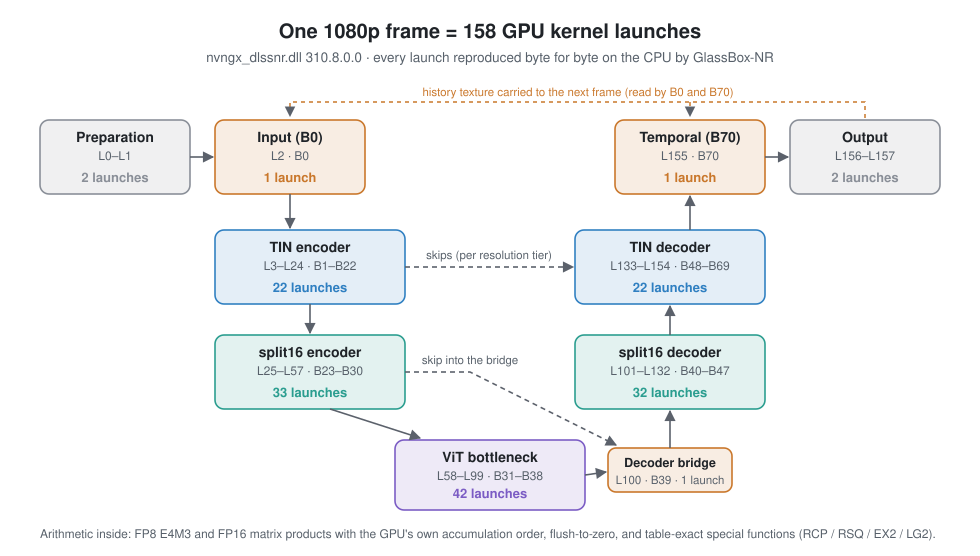

# GlassBox-NR Anatomy

**What it is.** A layer-by-layer account of how DLSS5NR, NVIDIA's neural renderer (exactly the shipped
`nvngx_dlssnr.dll` 310.8.0.0, no other version), computes a frame in 158 kernel launches, written down precisely enough
that its CPU reimplementation, [GlassBox-NR](https://github.com/Ashley-QwQ/GlassBox-NR), reproduces the output byte for
byte: at 1080p, 1440p and 4K, over several frames each, every byte of the final image is identical, not just close.
In Chinese and English. 
**Why it is hard.** Bit-exactness leaves no room for "close enough": FP8 (E4M3) and FP16 matrix products in the GPU's own
accumulation order, flush-to-zero boundaries, and special functions such as reciprocal and reciprocal square root that
only match through certified tables. 
**Why it is worth reading.** Every rule comes with how it was established and how far it reaches. The number-format pages
(L4) and their small worked examples are useful to anyone porting or verifying low-precision inference.

Implementation-level architectural dissection of one specific neural-rendering implementation:
`nvngx_dlssnr.dll` **310.8.0.0** (and nothing else). Companion to the CPU reference implementation
[GlassBox-NR](https://github.com/Ashley-QwQ/GlassBox-NR).

GlassBox-NR answers: *can the inference be reproduced bit-exactly on a CPU?*
This repository answers: *what exactly happens inside it, and how do we know?*

## How to read it

- Chinese (source text): start at [`skewer/INDEX.md`](skewer/INDEX.md).
- English (page-for-page translation of the Chinese pages, which remain the source text): start at
  [`skewer-en/INDEX.md`](skewer-en/INDEX.md). Same 48 pages, anchors, links, code blocks and coverage comments;
  [`skewer-en/examples/verify_en.py`](skewer-en/examples/verify_en.py) checks that structure against `skewer/`.

The "onion skewer" peels L0 (one frame) → L1 (10 stages) → L2 (kernel families) → L3 (how an operator computes) →
L4 (number formats, accumulation, rounding). Beginner primers and a glossary sit beside the levels; appendices hold
the evidence history, CPU storage of the function tables, and the reproduction entry.

## Running things

- [`skewer/REPRODUCE.md`](skewer/REPRODUCE.md) ([English](skewer-en/REPRODUCE.md)) says which version set to use
  (recommended: GlassBox-NR [v2.0.3-preview](https://github.com/Ashley-QwQ/GlassBox-NR/releases/tag/v2.0.3-preview))
  and what each public run checks: the 1080p frame-0 chain, the 1080p frame 0 → frame 1 two-frame chain, local
  scalar examples, and the L56 asset-to-executor loader.
- The examples in `skewer/examples/` take `--source-root`, `--tables`, `--payload` and `--out`; see
  [`_roots.py`](skewer/examples/_roots.py). They use artificial inputs or integer maps only.

## What this is and is not

- No NVIDIA binary, weight values, program counters, instruction forms or register names are included. Behaviour is
  described at the level that was verified byte-for-byte against GPU captures; inferred items are marked as such
  (【推测】 / [Speculation], INFERRED, UNKNOWN, NOT_ESTABLISHED).
- Claims are measured, not proven; the formal equivalence proof is NOT_ESTABLISHED. Each page's "how we know" lines
  give the evidence tier and scope of what it states.
- Many evidence links point into the authors' private project archive (`../../../experiments/…`, local paths such as
  `E:/…`, round names). They do not resolve here and are kept as provenance records. Code citations point to fixed
  commits of the public GlassBox-NR repository.
- Known open items are listed where they arise, for example the independent image-coordinate calibration of some
  table-driven layers, and two-frame runs beyond the published 1080p f0 → f1 pair.

This public repository is a snapshot of the authors' working repository; the revision history stays private.

## Licence

Documentation (the Markdown pages, figures including `img/`, and this README): **CC-BY-4.0** (`LICENSE-docs`). Code and data in
`skewer/examples/` and `skewer-en/examples/`: **Apache-2.0** (`LICENSE`). Details in `NOTICE`.
