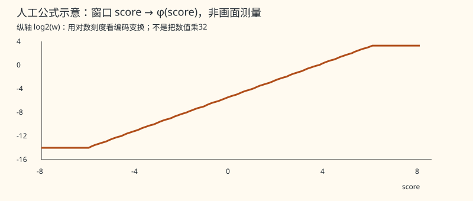

# How One Block Modifies Numbers, Exchanges Content, and Reconnects Two Bypasses

Previous stop: [Full-Frame Functional Diagram](L0_frame.md#beginner-frame) · Next stop: [Two Frames and Reset](L1_00_history_primer.md) · [Back to Index](INDEX.md) · [Look Up Terms as Needed](APPENDIX_beginner_glossary.md)

This page selects a **1-head [TIN](APPENDIX_beginner_glossary.md#g011) consecutive block with 32 items per position** to teach the complete wiring first. Each position holds a sequence of internal numbers, and each item in that sequence is called a [channel](APPENDIX_beginner_glossary.md#g007); it does not necessarily represent a visible color. A [window](APPENDIX_beginner_glossary.md#g015) is 8×8 such positions; below we scale the story down to three positions. All scaled-down numeric examples are **synthetic teaching examples, not measurements, model coefficients, or actual network outputs**; the actual block still computes over 64 positions, 32 items per head, and the original rounding rules. [Actual wiring](L3_tin_window.md#tin-window)

## First Modify Each Position's Own Number Sequence Independently

[Feed-forward](APPENDIX_beginner_glossary.md#g037) processing (FFN) here first combines channels independently at each position, then passes each item through the same function G, and finally combines them back to the original item count. This sub-stage does not fetch content from neighbors. [Projection](APPENDIX_beginner_glossary.md#g038) simply means "recombining a sequence of numbers using coefficients"; expansion and contraction refer to increasing and decreasing the intermediate item count, not enlarging or shrinking the image. G modifies each item according to its own magnitude rather than having only on/off outputs.

~~~mermaid
flowchart LR
    A["Position A: 2 items"] --> A4["Combine into 4 items"] --> AG["Each item passes through G"] --> A2["Combine back into 2 items"]
    B["Position B: 2 items"] --> B4["Combine into 4 items"] --> BG["Each item passes through G"] --> B2["Combine back into 2 items"]
~~~

**Synthetic combination example**: Position A's (1,2) can first be combined into (1,2,3,−1), and Position B's (2,1) into (2,1,3,1)—for instance, taking the sum of the first two items as the third item and their difference as the fourth. This illustrates only "combination within the same position" without using actual [weights](APPENDIX_beginner_glossary.md#g079). For the actual single-input shape of G and the synthetic example where x=4 yields exit value 7, see [Gate Function](L3_ffn.md#gate). The actual block selected here is 32→128→G→32 and does not copy this 2→4 toy width.

## Next Ask: Whose Content Should This Position Fetch?

Each position generates three sets of numbers from the feed-forward result: Q is the comparison number it uses to ask, K is the number others present to be compared against, and V is the content that may finally be retrieved. All three are obtained by projecting internal numbers; they are not three input images. In the actual block, Q and K also [scale](APPENDIX_beginner_glossary.md#g031) each group of 32 items overall; V skips this scaling.

**Synthetic three-position story, temporarily using 1 item in place of 32 and ignoring precision and [position bias](APPENDIX_beginner_glossary.md#g052)**: Position A takes Q=1, multiplies item by item with K=−1/0/1 of Positions A/B/C and sums, obtaining scores −1/0/1. The V contents at the three positions are synthetically set to 2/4/8. Turning the scores into positive numbers and dividing by the total to get [shares](APPENDIX_beginner_glossary.md#g048) tells us "how much Position A takes from A, how much from B, and how much from C"; the remaining positions each ask again using their own Q. Actual scores may also include position bias, so this example cannot be treated as the computation input of a real head.

| Same synthetic score | Standard [softmax](APPENDIX_beginner_glossary.md#g047): share after exp(s − max score) | Window φ(s) positive value in this chain | Share after dividing φ(s) by real-number total |
|---:|---:|---:|---:|
| −1 | 0.090031 | 0.00927734375 | 0.091787 |
| 0 | 0.244728 | 0.025390625 | 0.251208 |
| 1 | 0.665241 | 0.06640625 | 0.657005 |

Standard softmax takes the [exponential](APPENDIX_beginner_glossary.md#g047) first and then divides by the total; subtracting the maximum score prevents intermediate numbers from growing too large without changing the ideal real-number shares. Position A's combined content is about 6.4809. The window column for this chain first computes φ using the actual score transform and then divides in real numbers for teaching purposes, giving a combined content of about 6.4444; **the shares and content combination have not yet passed through the actual [half](APPENDIX_beginner_glossary.md#g054) [denominator tree](APPENDIX_beginner_glossary.md#g050), reciprocal table, coarse-format [quantization](APPENDIX_beginner_glossary.md#g061), or [matrix](APPENDIX_beginner_glossary.md#g051) accumulation**, so they are not called network results. The two sets of shares differ, and training intent is not guessed from this. The [synthetic calculation script and results](../skewer/examples/beginner_r04m.py) verify the display rounding in the table.

In the figure below, the horizontal axis is the score s; setting w=φ(s)>0, the vertical axis plots log2(w). Negative tick marks on the vertical axis still correspond to positive w; for example, log2(w)=−4 means w=1/16.

φ works by applying a multiply-add, clamping to a range, and then reinterpreting the storage [encoding](APPENDIX_beginner_glossary.md#g057); it neither multiplies the numeric value by 32 nor computes an exact exp. A synthetic c=1.5 has half encoding 0x3e00: after the window transform the encoding is 0x4000, which decodes as 2, whereas the numeric product 1.5×32 is 48. The exponential-like shape comes from bits in the encoding crossing into a new exponent bin; why training adopted this remains unknown. [Exact transform](L3_attention_softmax.md#window-attention)

## "Divide First or Divide Later" Must Be Drawn in Different Positions

The diagram below explains only the conversion position. Coarse format refers to [E4M3](APPENDIX_beginner_glossary.md#g055), a one-byte format that can store only a smaller set of number points; conversion may discard information.

~~~mermaid
flowchart LR
    W["Window: positive weights"] --> WD["Divide by total"] --> WQ["Convert to coarse format"] --> WV["Combine V content"] --> WO["Convert result to coarse format again"]
    G["Global: positive weights"] --> GQ["Convert to coarse format"] --> GV["Combine V content"] --> GD["Divide by total"] --> GO["Convert result to coarse format again"]
    style WQ fill:#ffe0a3,stroke:#9c5f00
    style GQ fill:#ffe0a3,stroke:#9c5f00
~~~

Here "divide" is implemented by multiplying by a specified reciprocal, preserving association order and per-step rounding. Global and window attention also differ in φ and in their summation trees; one cannot substitute one for the other simply by moving the division step. The existing [64-key synthetic example](L3_attention_softmax.md#parallel-av-example) evaluates to −8 for window and −3.25 for global, and that difference cannot be attributed entirely to the conversion position. After rounding, the shares are not guaranteed to sum to 1 either.

## Now Wire Up the Complete Block

A [bypass](APPENDIX_beginner_glossary.md#g016) temporarily saves earlier numbers so they route around a processing stage and reconnect later. Inside a block, this kind of reconnection is also called a [residual](APPENDIX_beginner_glossary.md#g017); here [seed](APPENDIX_beginner_glossary.md#g042) means the **starting subtotal** of a matrix accumulation, not a random seed.

~~~mermaid
flowchart TD
    X["Block entry: 32 items per position"] --> EX["Per position independently: combine into 128 items, apply G itemwise"]
    EX --> CT["Contract back to 32 items: first step brings in red-line subtotal"]
    X --> ResFirst["Entry numbers × bypass scale"] --> CT
    CT --> Z["Feed-forward result z: retain an unquantized copy"]
    Z --> QS["Separately convert to coarse format; generate Q/K/V"]
    QS --> CMP["Scale Q/K overall; compare positions, turn into positive weights"]
    QS --> V["V content"]
    CMP --> MIX["Window divides by total first, converts to coarse format, then combines V"]
    V --> MIX
    MIX --> PR["Output projection: first step brings in blue-line subtotal"]
    Z --> ResSecond["z × another bypass scale"] --> PR
    PR --> Y["Block result: still 32 items per position"]
    style ResFirst fill:#ffd9d9,stroke:#aa2222
    style ResSecond fill:#d9e9ff,stroke:#2255aa
    linkStyle 2,3 stroke:#aa2222,stroke-width:3px
    linkStyle 11,12 stroke:#2255aa,stroke-width:3px
~~~

The red line starts at the **block entry**, bypasses expansion and G, and enters at the first step of contraction; the blue line starts at the **feed-forward result z**, bypasses position comparison and content aggregation, and enters at the first step of output projection. Once brought in, each [32-item small basket](L1_00_numbers_primer.md#baskets) (each basket processes the products of 32 pairs of input numbers, not 32 positions or threads) continues saving a half subtotal at each step, so the two lines cannot be redrawn as additions performed after everything else finishes. This diagram specifically covers a 1-head consecutive block; exceptions for [upsampling](APPENDIX_beginner_glossary.md#g021) entries, multi-head grouping, and global slicing remain in the [actual variant table](L3_ffn.md#channels).

## Do Not Draw the Four Kinds of "Grouping" as the Same Axis

Position grid → select an 8×8 window → split the comparison numbers into several heads → 32 items per head. [split16](APPENDIX_beginner_glossary.md#g013) has 16 such heads; its eight FFN groups are a separate channel-computation grouping. Device execution coordinates such as [lane](APPENDIX_beginner_glossary.md#g087) and CTA are work-assignment coordinates, not heads or image coordinates. [Grouping details](L3_split16_window.md#heads)

After closing this page, you should be able to redraw three steps: each position modifies its own numbers → positions compare and combine content from elsewhere → earlier numbers reconnect at the two proper starting points. Next stop: view the [full-frame six bypasses](L0_frame.md#beginner-frame) or the [history timeline](L1_00_history_primer.md).
