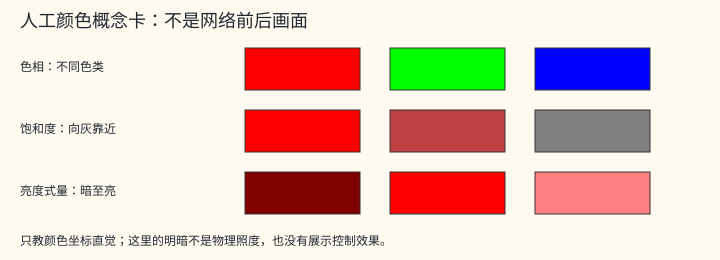

# L3.b70-history-output: Final Block, Display Output, and History Loop

> Some evidence links on this page point into the authors' private project archive (`../../../experiments/…`, `E:/…` and similar); they do not open in the public repository and are kept as provenance records. See the [evidence path legend](INDEX.md#private-links).

<!-- beginner-r04m:start intro -->

[Beginner Simplification] First distinguish four objects: ① three predicted numbers modify RGB; ② when [history](APPENDIX_beginner_glossary.md#g024) is present, the fourth predicted number participates in the blending [share](APPENDIX_beginner_glossary.md#g048); ③ the fourth stored component of the result image is fixed at 1; ④ display strength controls the final blending with the current-frame original-image backup. ②, ③, and ④ are not the same fourth number. By default, the pre-display [state](APPENDIX_beginner_glossary.md#g002) is saved first, and display processing is done separately; read the [two-frame-plus-reset timeline](L1_00_history_primer.md#timeline) before the detailed coordinate/color formulas. The B70 [resource](APPENDIX_beginner_glossary.md#g079) [confidence scale](APPENDIX_beginner_glossary.md#g052) is checked first, and the old image is fetched only if permitted; B0 conditioning history is a separate path.

~~~mermaid
flowchart TD
    Pred["Prediction exit"] --> Three["① Three predicted numbers → modify RGB"]
    Pred --> Fourth["② Fourth predicted number → participates only in history blending"]
    Three --> Colour["Current-frame new RGB"]
    Fourth --> Colour
    Colour --> Stored["③ Stored image: RGB plus fixed fourth component 1"]
    Colour --> Display["④ Separate display strength: blended with current-frame original-image backup"]
~~~

These synthetic color swatches teach concepts only: [hue](APPENDIX_beginner_glossary.md#g033) is the color category such as red or green, saturation indicates how far a color is from gray, and the lightness-like quantity is a computational convention reflecting light and dark rather than physical illuminance. The real color chain applies a numeric curve first, followed by two rounds of decomposition/recomposition; the temporary [channel](APPENDIX_beginner_glossary.md#g007) order is not the final RGB:

~~~mermaid
flowchart LR
    X["Pre-display color"] --> C["Gain and curve"] --> F["First round: decompose three quantities by extrema"] --> S["Adjust saturation"] --> T["Recompose in temporary channel order"] --> R["Second round: decompose in another order"] --> S2["Power-form saturation transform"] --> RGB["Recompose into final RGB"] --> I["Blend with current-frame backup by display strength"]
~~~

This is a simplification of the [real two-round wiring](#post-reconstruct) below; the synthetic color swatches are not used to claim actual visual effects, nor is this replaced by a single standard-library color-space round trip.
<!-- beginner-r04m:end intro -->

## Write-Borrow Contract for the 156 Route (V01.05, Rank 70)

When the set of integer [texture](APPENDIX_beginner_glossary.md#g027) keys is exactly {1,2,3,6}, default-numbered L155 writes id2; otherwise L155 writes id9. L156 writes id6, and L157 writes id2. The [workspace](APPENDIX_beginner_glossary.md#g082) is always marked writable; for every pair of buffers, as long as at least one side is writable, sharing the same underlying owner or having intersecting half-open byte intervals is rejected. owner recursively unwraps memoryview.obj or base, rejecting cycles; a multidimensional span computes low/high from the positive/negative parts of `(shape−1)*stride` along each dimension and then adds itemsize, supporting negative strides. Conflicts are not checked between two read-only objects; when the extent is unavailable, identical owners are still checked, which cannot be called a complete address proof. This interface uses default numbering without subtracting the route index a second time. [R2c owner_guard.py:8–39](../../../experiments/parity-cpp-param-change-r01-20261024-codex/stage_d1b_r2c/returned/snapshot/candidate/runtime/owner_guard.py#L8).

## B70 Unpacking, Head Arrangement, and Views (F43.02/F43.47, Ranks 77, 81)

[Matrices](APPENDIX_beginner_glossary.md#g051) follow the [TIN ordinary tile byte formula](L3_tin_window.md#resource-layout-r04l), with internal column-major `cols[n*K+k]`; w1(32,128)@0, w2(128,32)@0x1000, qkv(32,96)@0x20d0, [proj](APPENDIX_beginner_glossary.md#g038)(32,32)@0x4ce0. The [half](APPENDIX_beginner_glossary.md#g054) arrays fc/sin/cos/ac have 32 items each, with [base addresses](APPENDIX_beginner_glossary.md#g084) 0x2010/0x2050/0x2090/0x50e0; scale is the [F32](APPENDIX_beginner_glossary.md#g056) at 0x4cd0 rounded via [RN16](APPENDIX_beginner_glossary.md#g059). The addresses of the two 4×16 half heads are `base+(4*c+k//4)*16+2*(k%4)` with base=0x5130/0x5330; intermediate gap bytes are not mistaken for adjacent coefficients. [outtail.cpp:77–85](https://github.com/Ashley-QwQ/GlassBox-NR/blob/e4a9b4214c723015ff4a99d73f13aa9a4a8ed1ec/cpp/chain_outtail_optm/outtail.cpp#L77).

`km=(0,1,8,9,2,3,10,11,4,5,12,13,6,7,14,15)`, and the two input paths to the head are `a[k]=Y[km[k]], b[k]=Y[16+km[k]]`; first compute the [K16](APPENDIX_beginner_glossary.md#g065) of a from [+0](APPENDIX_beginner_glossary.md#g070), then use that half output as the [seed](APPENDIX_beginner_glossary.md#g042) for b, which cannot be concatenated into a single K32. [reset](APPENDIX_beginner_glossary.md#g032) computes the three RGB heads, while temporal can compute the fourth head; trace still outputs only RGB. [outtail.cpp:94](https://github.com/Ashley-QwQ/GlassBox-NR/blob/e4a9b4214c723015ff4a99d73f13aa9a4a8ed1ec/cpp/chain_outtail_optm/outtail.cpp#L94).

The bias index is defined from the 12 coordinate bits of query=(y,x) and key=(ky,kx), with the output bits from high to low ordered as `(y2,x2,ky2,kx2,y0,x1,x0,ky0,kx1,ky1,y1,kx0)`; read `LE16(resource+0x2cd0+2*index)`. The C32 [TIN](APPENDIX_beginner_glossary.md#g011) physical address of [skip](APPENDIX_beginner_glossary.md#g016) directly uses the [bidirectional view formula](L3_tin_window.md#view-layout-r04l); the physical address of feature [outview](APPENDIX_beginner_glossary.md#g022) is `16*((c//16*(NH//2)+y//2)*(NW//2)+x//2)+Q_inverse[c%16]`. These are CPU layout formulas; the independent native coordinates of B69 remain [UNKNOWN](APPENDIX_beginner_glossary.md#g104). [outtail.cpp:79–82](https://github.com/Ashley-QwQ/GlassBox-NR/blob/e4a9b4214c723015ff4a99d73f13aa9a4a8ed1ec/cpp/chain_outtail_optm/outtail.cpp#L79).

## B70 Denominator and Current-Color Coordinates (Ranks 79, 83)

On this page, `T_rcp/T_ex/T_lg` are shorthand for the [F32 numeric wrappers](L4_mufu.md#value-wrapper) of certified RCP/EX2/LG2 respectively; numeric suffixes mark call sites. Inputs and return values are F32 numeric values; extracting the bit pattern and decoding add no rounding and preserve the sign of zero, while certified membership and acceptance domains are still checked per site.

After the existing 64-item ordered half [reduction](APPENDIX_beginner_glossary.md#g050), first compute `d=max_half(den,0x0410)`, then `r=RN16(T_rcp(F32(d)))`, and for each weight `Q8(RN16(weight*r))`. This uses the [raw32](APPENDIX_beginner_glossary.md#g057) [RCP](APPENDIX_beginner_glossary.md#g072) wrapper without TIN's [0x1c00,0x60e0] rejection; the function data remains TABLE. [outtail.cpp:91–92](https://github.com/Ashley-QwQ/GlassBox-NR/blob/e4a9b4214c723015ff4a99d73f13aa9a4a8ed1ec/cpp/chain_outtail_optm/outtail.cpp#L91), [function contract](L4_mufu.md#lookup-contract-r04l).

Let FA/FM/FF be the [existing F32 add/mul/fma boundaries](L4_fp32_ftz.md#fp32-ftz) respectively, with `iw=T_rcp(F32(CW)), ih=T_rcp(F32(CH))`. `u=FM(FF(FM(FA(F32(x),0.5),iw),CB+0x48,CB+0x40),CB+0x50)`, `v=FM(FF(FM(FA(F32(y),0.5),ih),CB+0x4c,CB+0x44),CB+0x54)`, where all six [CB](APPENDIX_beginner_glossary.md#g083) fields are f32. Check `abs(u*CW−0.5−x)≤1/1024` in binary64, and the analogous formula for y; reject on failure, and read the texel center by the current texture pitch only on success. The CB transform cannot be simplified to (x+0.5)/W. [outtail.cpp:85, 95](https://github.com/Ashley-QwQ/GlassBox-NR/blob/e4a9b4214c723015ff4a99d73f13aa9a4a8ed1ec/cpp/chain_outtail_optm/outtail.cpp#L95).

## Zero Sign in the S157 Parent Branch (F44.02/V04.02, Ranks 217, 224)

The [admission](APPENDIX_beginner_glossary.md#g101) predicate is "parent floating-point predicate OR 15 exact u32 tuples." The parent branch compares F32 numeric values item by item: `exposure==−0.1f, contrast==−0.25f, satgain==−0.1f, gain2==0, strength==1`; consequently, both +0 and −0 for gain2 pass the parent branch, whereas [NaN](APPENDIX_beginner_glossary.md#g069) comparisons fail. Only the 15 extended items are compared against the [appendix bit-by-bit table](APPENDIX_evidence_history.md#param-change-tuples-r04h), with no [interpolation](APPENDIX_beginner_glossary.md#g020) and without calling the parent branch bitwise unique across the whole tuple. [Parent source:70–71](https://github.com/Ashley-QwQ/GlassBox-NR/blob/e4a9b4214c723015ff4a99d73f13aa9a4a8ed1ec/cpp/chain_outtail_optm/outtail.cpp#L70), [R2c:69–90](../../../experiments/parity-cpp-param-change-r01-20261024-codex/stage_d1b_r2c/returned/snapshot/candidate/repo/cpp/opt/M/outtail/outtail.cpp#L69).

[CPU Reconstruction / CENSUS] The text below explains the wiring by input, color correction, history blending, and display processing; for parameter-branch evidence, see the appendix separately. Training motivations and the design reasons for kernel splitting are unknown, and speculation is not added slice by slice.

[Full Skewer Index](INDEX.md) · Parent level: [B70](L2_09_b70.md), [Shared Copy](L2_01_prepare.md#copy), [L157](L2_10_output.md#postprocess) · Previous end: [B0](L3_b0_input.md#b0-noise-reprojection)

## Local Notation on This Page

For global formats, operations, and evidence labels, see [INDEX](INDEX.md#shape-and-workspace-notation).

| Local symbol | Meaning |
|---|---|
| dh, confidence | Terminal half prediction [vector](APPENDIX_beginner_glossary.md#g076), and confidence scale in the resource |
| a,b,c,δ; I | Four F32 control scalars of L157; final display strength |
| HSL_Fwd / HSL_Rev, Hue | Forward/reverse channel-order decomposition, and piecewise hue recomposition |
| h,s,l | Hue, saturation, and lightness-like quantity, not [launch](APPENDIX_beginner_glossary.md#g080) numbers |

**Tail-section provenance is stated per Decision 40: the logic was obtained by analyzing the NVIDIA binary, and the code is an independent rewrite verified byte for byte against [GPU](APPENDIX_beginner_glossary.md#g078) measurements.** This applies to B70/S157; it neither implies that the logic was obtained without binary analysis nor expands the measured input domain. Sources: [User Decision 40:299–309](../../../tasks/USER_DECISIONS_20261012_ZH.md#决定-402026-10-20用户q1-审计后的发布裁定), [M2 RESULT](../../../experiments/parity-cpp-m2-release-clean-r01-20261020-claude/RESULT_ZH.md). This page lists only behavior, parameters, and data formats.

### L3.b70-history-output Two Exits and One Cross-Frame Loop (L155–L157)

- What it is: B70 produces the state prior to display processing; L156 saves it, and L157 performs display compositing separately.
- Input → output: [Decoder](APPENDIX_beginner_glossary.md#g009) and B0 [features](APPENDIX_beginner_glossary.md#g008), current RGB, valid history, and [MV](APPENDIX_beginner_glossary.md#g023) → id9, which then flows separately to id6 and id2.
- How it is computed:
  ~~~text
  1. B69 main path and B0.full bypass → B70 window block → terminal half prediction.
  2. Correct current color using the prediction to obtain encoded RGB.
  3. When history is valid and the confidence scale is greater than zero, reproject raw history RGB and perform fused blending.
  4. Write RGB to id9 via RZ16 with alpha=1.
  5. L156 copies id9's RGBA16F to id6 row by row.
  6. L157 reads id9 and id10, composites via the color chain and intensity, and writes id2.
  7. Next-frame B0 / B70 reads id6; post-display id2 does not replace history.
  ~~~
- Numeric rules: State [publication](APPENDIX_beginner_glossary.md#g091) and display publication are both half, but their preceding computations and [clamping](APPENDIX_beginner_glossary.md#g049) positions differ; do not feed L157's color transform back into history.
- How we know: [CENSUS](APPENDIX_beginner_glossary.md#g100), [outtail.cpp:85–105](https://github.com/Ashley-QwQ/GlassBox-NR/blob/e4a9b4214c723015ff4a99d73f13aa9a4a8ed1ec/cpp/chain_outtail_optm/outtail.cpp#L85); for named multiframe gates, see the [evidence table](#evidence).
- Next down: [B70 Network](#b70-network), [Raw Color](#b70-current), [Temporal Branch](#b70-temporal), [Copy](#copy), [Display](#postprocess), [reset and carry](#loop).

~~~mermaid
flowchart LR
  Caller["Current-frame color / MV / params"] --> B0["B0"]
  Hist["id6 history"] --> B0
  B0 --> Net["Encoder → bottleneck → decoder B69"]
  B0 -->|"full skip"| B70["B70"]
  Net --> B70
  Caller --> B70
  Hist --> B70
  B70 --> S9["id9 RGBA16F"]
  S9 --> Copy["L156 row-by-row copy"]
  Copy -->|"Next frame"| Hist
  S9 --> Post["L157"]
  Base["id10 display base"] --> Post
  Post --> Display["id2 display output"]
~~~

### L3.b70.network Two-Way Feature Merge, Window Block, and Terminal Prediction

- What it is: Merges the half-resolution decoded features with the full-resolution entry bypass and generates per-pixel predictions through one [window](APPENDIX_beginner_glossary.md#g015) block.
- Input → output: B69 outview [E4](APPENDIX_beginner_glossary.md#g055)[Hn/2,Wn/2,32], B0.[full](APPENDIX_beginner_glossary.md#g018) E4[Hn,Wn,32], and B70 weights → half dh[3], or dh[4] when history is present.
- How it is computed:
  ~~~text
  1. Position in each 8×8 window: x=8bx−4+tx, y=8by−4+ty.
  2. Inside the canvas: read main path (x//2,y//2,c) by outview layout, and read full skip (x,y,c) by TIN layout.
  3. main=H×(decode(main_byte),s_main[c]); merge=HF(decode(skip_byte),s_skip[c],main).
  4. Q8(merge) → 32→128 feed-forward expansion / gate function → 128→32 contraction, with seed=H×(merge,s_ff).
  5. Out-of-canvas positions keep z as half +0; all intra-window positions continue to generate Q/K/V.
  6. Apply norm32 to Q and to K separately, then multiply only Q by the query scale (K is not scaled); obtain the attention result from biased window scores, the specified denominator, and AV.
  7. Final projection uses H×(z,s_att) as seed, yielding yy[32] half.
  8. Split into two 16-item vectors a16, b16 according to the source-code channel permutation.
  9. dh[c]=HMMA_K16(b16,head2[c],HMMA_K16(a16,head1[c],seed=0)).
  10. reset/current-only computes the first three items; when the history handle is valid, additionally compute the fourth item.
  ~~~
- Numeric rules: The physical length of the main path is 8WnHn B, and that of the bypass is 32WnHn B; the same main-path position is reused across 2×2 image positions without [bilinear](APPENDIX_beginner_glossary.md#g029) interpolation. The two path [scales](APPENDIX_beginner_glossary.md#g031), [residual](APPENDIX_beginner_glossary.md#g017) scales, position biases, and terminal coefficients are stored as half, while the four window-block matrices are stored as E4; weight values are not listed. The two path scales named sin/cos in the source code are resource coefficients, not sine / cosine calls here.
- How we know: CENSUS, [outtail.cpp:77–94](https://github.com/Ashley-QwQ/GlassBox-NR/blob/e4a9b4214c723015ff4a99d73f13aa9a4a8ed1ec/cpp/chain_outtail_optm/outtail.cpp#L77); for the two K16 publications of HMMA, see [:60–61](https://github.com/Ashley-QwQ/GlassBox-NR/blob/e4a9b4214c723015ff4a99d73f13aa9a4a8ed1ec/cpp/chain_outtail_optm/outtail.cpp#L60).
- Next down: [FFN Gate Function and merge Residual](L3_ffn.md#channels); reuses [QMMA](L3_qmma_e4m3.md#qmma-e4m3), [norm32](L3_norm_nonfinite.md#norm32), and [Window attention](L3_attention_softmax.md#window-attention); for the color and history handoff unique to this block, see the [next slice](#b70-current).

### L3.b70.current Current Color, Neural Correction, and id9 Format

- What it is: Adds the first three predictions to the current-color path, and then decides whether to blend in history.
- Input → output: id1 RGB, dh[0:3], CB+0x30 (f32) → encoded RGB; final id9 is W×H [RGBA16F](APPENDIX_beginner_glossary.md#g028).
- How it is computed:
  ~~~text
  1. Compute current-color coordinates from the pixel center, reciprocal width/height, and the UV transform in params.
  2. The current admission path checks that the error from this pixel center is ≤1/1024, and then directly reads id1[y,x].
  3. For each RGB component: base=F32_FMA(color,0.125,−0.0625).
  4. val=F32_FMA(F32(dh[c]),CB+0x30 (f32),base).
  5. encoded[c]=Sat01(F32+(0,F32_FMA(val,8,0.5))); retain this F32 result first.
  6. Without history, blended=encoded; with history, compute blended according to the next slice.
  7. Within valid image rows: id9.RGB=RZ16(blended), id9.A=half(1).
  ~~~
- Numeric rules: The three color transforms cannot be algebraically merged into a single "color plus prediction" expression. In the current three resolution tiers, the canvas width equals the image width, and the bottom Hn−H rows are not written to the texture; the current-color direct lookup has a coordinate guard and is not a general TEX over arbitrary UVs. There is no additional S clamping before the final B70 RGB writeback; temporal blending cannot add the display branch's clamp on its own.
- How we know: CENSUS, [outtail.cpp:85, 94–97](https://github.com/Ashley-QwQ/GlassBox-NR/blob/e4a9b4214c723015ff4a99d73f13aa9a4a8ed1ec/cpp/chain_outtail_optm/outtail.cpp#L94); for texture dimension / pitch / [identity](APPENDIX_beginner_glossary.md#g103) checks, see [:64–65, 100–102](https://github.com/Ashley-QwQ/GlassBox-NR/blob/e4a9b4214c723015ff4a99d73f13aa9a4a8ed1ec/cpp/chain_outtail_optm/outtail.cpp#L100).
- Next down: [History Raw RGB Blending](#b70-temporal), [L156](#copy), [Worked RZ Example](#worked-example).

**dh[3] is not written as [alpha](APPENDIX_beginner_glossary.md#g026).** It is an internal predicted quantity of the temporal branch; the fourth channel of id9 always writes 1. When the history input is valid but the resource confidence scale is zero, the code may still compute the fourth predicted value while skipping the history sampling function; one cannot assert from the mere presence of a [handle](APPENDIX_beginner_glossary.md#g096) that this numeric output consumed history.

**[Operator](APPENDIX_beginner_glossary.md#g035) intuition.** Ignoring rounding and clamping, 8×((0.125×color−0.0625)+s×dh)+0.5 is identically equal to color+8×s×dh; when dh=0, the original color is preserved. In practice, the respective publication / zero-sign contracts of the three F32_FMA operations, the extra F32+0, and Sat01 are preserved, so the code cannot be merged using the real-number identity.

### L3.b70.temporal B70's Own Coordinate Chain and 5-tap

- What it is: Samples MV at the current pixel, generates the history position, and then performs five filtered samples on raw history RGB.
- Input → output: id3 RG16F, id6 RGBA16F, and coordinate transforms in params → weighted RGB and normalization reciprocal.
- How it is computed:
  ~~~text
  1. rw=T_rcp(W), rh=T_rcp(H); ux=F32×(F32+(x,0.5),rw), uy=F32×(F32+(y,0.5),rh).
  2. mv_u=F32×(F32_FMA(CB+0x94 (f32),ux,CB+0x8c (f32)),CB+0x9c (f32)); mv_v corresponds on the other axis, using CB+0x98 (f32)/CB+0x90 (f32)/CB+0xa0 (f32).
  3. Fetch mx,my at motion.sample(mv_u,mv_v).
  4. Current admission mode=1: ax=F32_FMA(CB+0xa4 (f32),mx,ux), ay=F32_FMA(CB+0xa8 (f32),my,uy).
  5. x0=F32+(floor(F32_FMA(W,ax,−0.5)),0.5), t=clamp(F32_FMA(W,ax,−x0),0,1); y0 and v likewise with H and ay. Neither the +0.5 after floor nor the clamp may be dropped.
  6. Construct the left / top / center / bottom / right five points and weights according to the cubic coefficients already expanded in B0; reciprocals here use T_rcp.
  7. Transform history point sx,sy again: hx=F32×(F32_FMA(CB+0x7c (f32),F32×(rw,sx),CB+0x74 (f32)),CB+0x84 (f32)); hy uses CB+0x80 (f32)/CB+0x78 (f32)/CB+0x88 (f32).
  8. history.sample(hx,hy,c) returns the raw color; it does not perform B0's subtraction of 0.5 and multiplication by gain.
  9. den=F32+(wr,F32+(wb,F32+(wc,F32+(wl,wt)))); inv=T_rcp(den).
  10. weighted=F32×(top,wt), followed in order by F32_FMA(left,wl,weighted), F32_FMA(center,wc,weighted).
  11. Then F32_FMA(bottom,wb,weighted), F32_FMA(right,wr,weighted).
  ~~~
- Numeric rules: F32 operation points, coordinate clamping, the [FMA](APPENDIX_beginner_glossary.md#g063) before floor, and the weighting order are preserved. sample accepts normalized coordinates, multiplies internally by texture width and height, and then uses the 1/256 fixed-point subpixel grid and joint 8-bit fractional weights, followed by active-contribution shared-[exponent](APPENDIX_beginner_glossary.md#g058) truncation and texture half ties-away; the mechanism links to the [B0 filtering description](L3_b0_input.md#texture), while B70's address transforms, RCP / [FTZ](APPENDIX_beginner_glossary.md#g068) wrappers, and final blending are bound separately. The outer current function requires mode=1, and internal fallback branches cannot be treated as newly supported domains.
- Three small examples for step 5 (W=1920, x axis only; each ax is exactly representable in F32 and the FMA results are exact): pixel center ax=1/256, W·ax=7.5, giving x0=7.5, t=0; fractional offset ax=3/512, W·ax=11.25, giving x0=10.5, t=0.75; left edge ax=0, giving x0=−0.5, t=0.5, and the left and right points x0−1, x0+2 of the five are then clamped to [0.5, W−0.5], i.e. 0.5 and 1.5. Dropping the +0.5 after floor would turn x0 into 7, 10, −1 and t into 0.5, 1 (1.25 clamped back), 1, which changes the cubic coefficients and the five sample positions that follow. The comparison is against the CPU source [b70_temporal.hpp:33–34](https://github.com/Ashley-QwQ/GlassBox-NR/blob/e4a9b4214c723015ff4a99d73f13aa9a4a8ed1ec/cpp/chain_outtail_optm/b70_temporal.hpp#L33); no separate claim is made about the native internal representation.
- How we know: CENSUS, [b70_temporal.hpp:5–44, 47](https://github.com/Ashley-QwQ/GlassBox-NR/blob/e4a9b4214c723015ff4a99d73f13aa9a4a8ed1ec/cpp/chain_outtail_optm/b70_temporal.hpp#L26); for the mode check, see [outtail.cpp:85](https://github.com/Ashley-QwQ/GlassBox-NR/blob/e4a9b4214c723015ff4a99d73f13aa9a4a8ed1ec/cpp/chain_outtail_optm/outtail.cpp#L85).
- Next down: [Confidence Blending](#b70-mix), [Existing 5-tap Coefficients](L3_b0_input.md#five-tap), [Scope of Saved Gates](#evidence).

### L3.b70.mix Fourth Predicted Value and Fused History Correction

- What it is: Turns the fourth predicted value into a bounded weight, and corrects current RGB using the difference between history and current encoded.
- Input → output: half dh[3], resource half confidence, weighted, inv, encoded → F32 blended.
- How it is computed:
  ~~~text
  1. confidence=Sat01(F32(resource confidence half)); nonfinite values are rejected.
  2. When confidence≤0, temporal sampling is not called, and blended=encoded.
  3. argument=F32×(F32(dh[3]),k), where the F32 algorithmic constant bit pattern of k is 0xbfb8aa3b.
  4. sigmoid=T_rcp(F32+(T_ex(argument),1)).
  5. factor=Sat01(F32_FMA(sigmoid,confidence,0)).
  6. Per channel: delta=F32_FMA(inv,weighted,−encoded[c]).
  7. blended[c]=F32_FMA(factor,delta,encoded[c]), followed only then by RZ16 publication.
  ~~~
- Numeric rules: k is an approximate constant for negative log2(e) that makes base-2 EX2 form a logistic-style gate; it is not a model weight. Values of confidence and terminal matrix coefficients are not listed. Normalization and subtraction of the current value share the single FMA on line 6, so one cannot first obtain normalized history and then subtract the current value; nor is there a step that first turns history into B0 normalized half.
- How we know: CENSUS, [b70_temporal.hpp:45–49](https://github.com/Ashley-QwQ/GlassBox-NR/blob/e4a9b4214c723015ff4a99d73f13aa9a4a8ed1ec/cpp/chain_outtail_optm/b70_temporal.hpp#L45), [outtail.cpp:96](https://github.com/Ashley-QwQ/GlassBox-NR/blob/e4a9b4214c723015ff4a99d73f13aa9a4a8ed1ec/cpp/chain_outtail_optm/outtail.cpp#L96); for temporal table / params profile guards, see [stage_codec.inc:70–85](https://github.com/Ashley-QwQ/GlassBox-NR/blob/e4a9b4214c723015ff4a99d73f13aa9a4a8ed1ec/cpp/chain_outtail_optm/stage_codec.inc#L70).
- Next down: [L156 State Saving](#copy), [History Consumption Controls](#reset-controls).

**Time boundary of 4K temporal execution.** The 10-22 unified M f0→f1→f2 two-fill own-state chain actually executed this 4K history entry; f2 used that fill's own f1 state. It neither merely configured b70_temporal.hpp nor continued via teacher forcing with native history. Earlier 1080 / 1440 temporal results are listed separately, and "4K f1/f2 executed for the first time in this round" must not be stated as if no geometry had temporal execution until 10-22. [4K RESULT:19–21](../../../experiments/parity-cpp-4k-multiframe-r01-20261022-codex/RESULT_ZH.md#L19).

### Current Color and Confidence Blending: Synthetic Pixel Through the Real Functions

color RGB=(0.5,0.5,0.5), synthetic prediction dh before converting to half is (0.01,0,−0.01,1), and host scale=0.03125; confidence is synthetically set to half(0.5), with pre-supplied filtered weighted RGB=(0.75,0.25,0.5) and denominator 1. No model coefficients are read, and no sampler/network is called.

| Channel | dh after conversion to half | base | val | encoded | delta | blended / [RZ16](APPENDIX_beginner_glossary.md#g060) encoding |
|---|---:|---:|---:|---:|---:|---|
| R | 0.01000213623 | 0 | 0.0003125667572 | 0.5025005341 | 0.2474994659 | 0.5929688215 / 38be |
| G | 0 | 0 | 0 | 0.5 | −0.25 | 0.4086176753 / 3689 |
| B | −0.01000213623 | 0 | −0.0003125667572 | 0.4974994659 | 0.002500534058 | 0.4984134734 / 37f9 |

The fourth predicted value gives argument=−1.442695022, real EX2=0.3678794503, RCP(EX2+1)=0.7310585976, and factor=0.3655292988. delta and blended use the original F32_FMA; the [script](../skewer/examples/anatomy_r04i.py) directly extracts the original color statements, original confidence-function fragment, and EX2/RCP wrappers, executes them after checking the certified table SHAs, and the [result](../skewer/examples/anatomy_r04i.result.json) saves the parameters and bit patterns. This is a synthetic arithmetic example, not a new B70 or model acceptance.

### L3.b70.variants Default 158 and 156 Routes

| Route | Terminal wiring |
|---|---|
| Default 158 | B70 writes id9, L156 copies id9→id6, L157 reads id9/id10 and writes id2 |
| 156 | Omits the default [L0](APPENDIX_beginner_glossary.md#g081) [base](APPENDIX_beginner_glossary.md#g003) backup and standalone L157 postprocessing; local 0..155 correspond to default 1..156, writing id2 at the tail end and then copying id2→id6; binds only the four textures 1/2/3/6 |

The 156 route uses the same tail state for both display and next-frame history, [parameter branch evidence](APPENDIX_evidence_history.md#param-change) (measured on child candidate). The 312 B post_block is a different parameter layout and is not treated as the 156 route merely because both belong to control changes.

### L3.history.copy L156: id9(this) → id6(next)

- What it is: Copies the full RGBA16F valid pixels row by row, saving the state read by the next frame.
- Input → output: W×H×8 B pixel payload of id9 → same-shape payload of id6.
- How it is computed:
  ~~~text
  1. Check in params that source texture handle=id9, destination surface=id6, and width/height equal the current-frame geometry.
  2. For y=0..H−1: src=id9.data+y×src_pitch.
  3. dst=id6.data+y×dst_pitch; memcpy(dst,src,8W).
  4. All raw bit patterns of the four RGBA half values are copied without decoding, quantization, or color transform.
  5. Keep id6 for the next frame while separately updating the caller's color, MV, and parameters.
  ~~~
- Numeric rules: Valid pixel bytes are identical byte for byte; if pitch is greater than 8W, end-of-row padding lies outside the copied range. The entire raw RGBA16F of the listed tightly packed captures is therefore identical, without claiming that all bytes of backing allocations with different pitches are also identical.
- How we know: CENSUS, [outtail.cpp:103](https://github.com/Ashley-QwQ/GlassBox-NR/blob/e4a9b4214c723015ff4a99d73f13aa9a4a8ed1ec/cpp/chain_outtail_optm/outtail.cpp#L103); the saved native self-consistency record [history_inputs_v3.json](../../../experiments/parity-video-1080-multiframe-r01-20261006-codex/resume2-20261007/history_inputs_v3.json) covers 5 cross-frame [seams](APPENDIX_beginner_glossary.md#g106) plus 12 intra-frame links, totaling 282,009,600 B with diff_bytes=0, and all 17 single-byte [negative controls](APPENDIX_beginner_glossary.md#g102) were detected.
- Next down: [carry and reset](#loop), [Small Copy / RZ Example](#worked-example).

| Image dimensions | Bytes copied per row (B) | Full pixel payload (B) |
|---|---:|---:|
| 1920×1080 | 15,360 | 16,588,800 |
| 2560×1440 | 20,480 | 29,491,200 |
| 3840×2160 | 30,720 | 66,355,200 |

The native seam record above is capture self-consistency, not CPU parity; normal completion of the original runner remains NOT_PROVEN. Comparison of the CPU own-state chain against native is a later, independent layer of evidence; see the [table](#evidence).

### L3.postprocess Inputs, Branches, and Naming Adjudication of L157

- What it is: Applies an explicit color transform to id9, then blends with the id10 base and writes only display id2.
- Input → output: RGB half of id9 / id10, 376 B params → id2 RGB RZ16, alpha=1.
- How it is computed:
  ~~~text
  1. Read id9 by image pixel / pitch and clamp to [0,1] first.
  2. Apply gain, a cubic curve, and two LG2 / EX2 round trips using the host scalars.
  3. Decompose h/s/l by max/min, adjust saturation, and recompose temporary channels piecewise.
  4. Decompose again in another channel order, apply a power-form saturation transform, and recompose RGB.
  5. Clamp the target RGB, take the difference with id10, and blend via FMA using intensity.
  6. Clamp the final RGB and write id2 via RZ16; write half(1) to alpha without modifying id6.
  ~~~
- Numeric rules: **This guarded branch in current [M2](APPENDIX_beginner_glossary.md#g107) is an HSL-style extrema / hue / saturation / lightness-like computation**. Its source code does not execute an Oklab conversion via an [LMS](APPENDIX_beginner_glossary.md#g034) matrix and cube-root chain; therefore, the legacy ARCH naming that broadly called this entry "Oklab" cannot replace the implementation of the current branch. Whether other native branches contain Oklab remains unconfirmed here; nor can a standard-library HSL conversion replace the special channel orders below.
- How we know: CENSUS, [outtail.cpp:70–75](https://github.com/Ashley-QwQ/GlassBox-NR/blob/e4a9b4214c723015ff4a99d73f13aa9a4a8ed1ec/cpp/chain_outtail_optm/outtail.cpp#L70), compared against the [legacy ARCH explanation §6.5](../../../ARCHITECTURE_V3_ZH.md#65-s157cg2r_post_process_kernell157); what is adjudicated here is the current code behavior without forcing the legacy explanation into the same algorithm.
- Next down: [Front Curve and Scalars](#post-curve), [Decomposition / Recomposition](#post-hsl), [Display Blending](#intensity).

### L3.postprocess.curve Three Host Scalars: Numeric Roles Read, API Names Undetermined

- What it is: Specifies where the scalars are consumed while retaining the unknown of "which host control generates them."
- Input → output: a=CB+0x144 (f32), b=CB+0x14c (f32), c=CB+0x150 (f32), plus δ=CB+0x154 (f32) → subsequent color chain.
- How it is computed:
  ~~~text
  1. ep=T_ex(a); ea=T_ex(+0), eb=T_ex(−0), eg=T_ex(−δ).
  2. For each id9 RGB: rawv=Sat01(F32+(0,F32(raw_half))).
  3. x=Sat01(F32_FMA(rawv,ep,0)); x2=F32×(x,x); twox=F32+(x,x); three=F32+(−twox,3).
  4. smooth=F32_FMA(x2,three,−x); pre=F32_FMA(smooth,b,x).
  5. u=T_ex_1(F32×(T_lg_0(pre),ea)).
  6. rgb=T_ex_3(F32×(T_lg_2(max(0,u)),eb)).
  7. First-round saturation in the next slice uses Sat01(F32_FMA(s,F32+(c,1),0)).
  ~~~
- Numeric rules: Mathematically the curve contains x²(3−2x)−x, but every addition, multiplication, and FMA grouping in the source code is preserved. Even when ea/eb equal 1, the LG2/EX2 round trips cannot be removed; they use the captured maps and per-site acceptance domains. The current M2 guard fixes this set of scalars and I=1, so the role in the code is not evidence that all cross-capture scalar values have been verified.
- Why it is computed this way: a forms the pre-gain, b blends the smooth curve, and c scales the first-round saturation; these are their functions within the formulas, which do not equal confirmed host API names.
- How we know: CENSUS, [outtail.cpp:68–75](https://github.com/Ashley-QwQ/GlassBox-NR/blob/e4a9b4214c723015ff4a99d73f13aa9a4a8ed1ec/cpp/chain_outtail_optm/outtail.cpp#L68); for why the host semantics remain undetermined, see [ARCH §10.2](../../../ARCHITECTURE_V3_ZH.md#102-参数字段审计host-params-audit-r01).
- Next down: [h/s/l](#post-hsl), [MUFU Domains](L4_mufu.md#edges).

| Scalar | Role confirmable from current code | Still unconfirmed |
|---|---|---|
| a at CB+0x144 (f32) | T_ex(a) is the pre-gain on RGB | What the host calls it, and how it is generated from content or UI |
| b at CB+0x14c (f32) | FMA coefficient blending smooth and x | Whether it corresponds to a standalone "contrast" control |
| c at CB+0x150 (f32) | First-round multiplier on s is F32+(c,1) | Whether it corresponds to a standalone "saturation" control |
| δ at CB+0x154 (f32) | Second-round power-form saturation uses T_ex(−δ) | Host contract for untested branches / non-default values |

Closure path for host field naming: fix the input, history, and remaining controls, vary the host API controls one by one, and record the exact bit patterns of the five CB fields together with reset/route; then perform repeats and single-variable counter-controls to distinguish host clamping from consumption by the color function. This controlled comparison is NOT_RUN in this round, and UI fields are not named from local variable names.

### L3.postprocess.hsl Two Decompositions and Piecewise Hue

- What it is: Constructs lightness and saturation from max/min, constructs hue according to the dominant channel, and then recomposes via a piecewise function.
- Input → output: Three F32 components r,g,b → h,s,l; then from p0,q,h → one channel.
- How it is computed:
  ~~~text
  1. mx=max(b,max(r,g)), mn=min(b,min(r,g)); l=F32×(F32+(mx,mn),0.5).
  2. If mx==mn: h=s=0, return immediately; otherwise d=F32+(mx,−mn), rd=T_rcp(d).
  3. Hue branches of HSL_Fwd: if mx==r use F32_FMA(F32+(g,−b),rd,g<b?6:0);
       else if mx==g use F32_FMA(F32+(b,−r),rd,2), else F32_FMA(F32+(r,−g),rd,4).
  4. HSL_Rev instead uses in order F32_FMA(F32+(b,−g),rd,2), F32_FMA(F32+(r,−b),rd,r<b?6:0), F32_FMA(F32+(g,−r),rd,4).
  5. h=F32×(branch_value,1/6); sm=F32+(mx,mn), minus=F32+(−mn,F32+(2,−mx)).
  6. s=F32×(d,T_rcp(l≤0.5?sm:minus)).
  7. Hue(p0,q,t): when t<0, F32+(t,1); when t≥1, F32+(t,−1); d=F32+(q,−p0).
  8. a0=F32_FMA(F32×(d,6),t,p0); c0=F32_FMA(F32×(d,F32+(2/3,−t)),6,p0).
  9. Return t<1/6?a0 : t<0.5?q : t<2/3?c0 : p0.
  ~~~
- Numeric rules: Fractional constants follow the F32 precision in the source code; the grayscale branch avoids taking the reciprocal of d=0. Equal maxima are selected in the source-code test order of r, then g, then b, without arbitrary [rearrangement](APPENDIX_beginner_glossary.md#g019).
- How we know: CENSUS, [outtail.cpp:72–73](https://github.com/Ashley-QwQ/GlassBox-NR/blob/e4a9b4214c723015ff4a99d73f13aa9a4a8ed1ec/cpp/chain_outtail_optm/outtail.cpp#L72).
- Next down: [Two-Round Wiring](#post-reconstruct), [FTZ Boundaries](L4_half_arith.md#f32-boundaries).

### L3.postprocess.reconstruct Two-Round Recomposition Preserving Temporary Channel Order

- What it is: Two rounds of decomposition / recomposition do not directly equal a single standard RGB↔HSL round trip.
- Input → output: Post-curve rgb, c, eg → display target RGB.
- How it is computed:
  ~~~text
  1. (h,s,l)=HSL_Fwd(rgb); sa=Sat01(F32_FMA(s,F32+(c,1),0)).
  2. Given sa: q=l<0.5?F32×(l,F32+(sa,1)):F32_FMA(−l,sa,F32+(l,sa)); p0=F32+(F32+(l,l),−q).
  3. tmp0=Hue(p0,q,h), tmp1=Hue(p0,q,F32+(h,1/3)), tmp2=Hue(p0,q,F32+(h,−1/3)).
  4. (h,s,l)=HSL_Rev(tmp0,tmp1,tmp2), rather than calling HSL_Fwd in the final RGB order.
  5. gray=(tmp0==tmp1 && tmp1==tmp2).
  6. sa=Sat01(F32+(0,T_ex(F32×(eg,T_lg(gray?1:s))))); when gray, set sa=0 afterward.
  7. Recompute p0, q according to line 2.
  8. Final RGB=[Hue(p0,q,F32+(h,1/3)),Hue(p0,q,h),Hue(p0,q,F32+(h,−1/3))].
  ~~~
- Numeric rules: Both the temporary order and the reverse hue branches are preserved; tmp0/1/2 cannot be treated directly as the final R/G/B. When gray, 1 is fed into the logarithm chain and saturation is still explicitly set to zero at the end, without substituting an approximate pow.
- How we know: CENSUS, [outtail.cpp:75](https://github.com/Ashley-QwQ/GlassBox-NR/blob/e4a9b4214c723015ff4a99d73f13aa9a4a8ed1ec/cpp/chain_outtail_optm/outtail.cpp#L75).
- Next down: [Strength Blending](#intensity), [RZ](#worked-example).

### L3.postprocess.intensity Display Strength Upper Bound and Final RZ

- What it is: The final blending between the display target and the id10 base; it is neither B70's learned residual nor the history confidence weight.
- Input → output: Target RGB, id10 RGB, I=CB+0x120 (f32) → id2 RGBA16F.
- How it is computed:
  ~~~text
  1. The upper bound of intensity in captured controls is 1.0; >1 controlled comparisons at 1.5 / 2.0 produce outputs equal to 1.0.
  2. For the current M2 entry, I==1 is required, and a general entry for arbitrary I is not implemented.
  3. Per component: d=F32+(Sat01(target[c]),−base[c]).
  4. mixed=Sat01(F32_FMA(I,d,base[c])).
  5. id2.RGB=RZ16(mixed), id2.A=half(1).
  ~~~
- Numeric rules: Upper-bound control observations and the code entry are kept separate: outtail.cpp:71 itself checks only I==1 and does not implement a general min(I,1). We do not fabricate which step of the shader performs clamping, nor do we infer a contract for untested negative [intensity](APPENDIX_beginner_glossary.md#g004) from the upper bound. The independent input closure for 0.5 is restricted to two single-frame samples on A/sm75/320×240 and is not extended to general dynamic parameters in M2.
- How we know: CENSUS, [outtail.cpp:71, 75](https://github.com/Ashley-QwQ/GlassBox-NR/blob/e4a9b4214c723015ff4a99d73f13aa9a4a8ed1ec/cpp/chain_outtail_optm/outtail.cpp#L71); CONTROLLED / historical control summary, [ARCH parameter table:1305](../../../ARCHITECTURE_V3_ZH.md#L1305), [P10c RESULT](../../../experiments/parity-gpt-cp-intensity-input-closure-p10c-20260919/RESULT_ZH.md).
- Next down: [Actual RZ Example](#worked-example), [Parameter-Change Route Boundary](#variants).

### Exact Control Tuples of S157

CB+0x120 (f32)/CB+0x144 (f32)/CB+0x14c (f32)/CB+0x150 (f32)/CB+0x154 (f32) are I/a/b/c/δ respectively; the restricted entry is [parent floating-point predicate OR extended bitwise tuples](#parent-predicate-r04l), with the color arithmetic and table-lookup decoding unchanged, [parameter branch evidence](APPENDIX_evidence_history.md#param-change) (measured on child candidate). Site membership, [function tables](APPENDIX_beginner_glossary.md#g074), and the remaining guards all take effect simultaneously, and single-channel function domains do not substitute for the binding of the cross-channel color branch.

### L3.history.loop What Is Stored Across Frames, and What reset Changes

- What it is: Separately continues the CPU own state, the host frame word, and stateless noise reconstruction across frames.
- Input → output: End-of-frame workspace / textures, next-frame caller inputs, and params → next B0 / B70.
- How it is computed:
  ~~~text
  1. Retain the entire workspace and texture state across frames; among them, id6 is the history just copied from id9.
  2. Each frame refreshes id1 color, id3 MV, and CB according to the contract, without using native intermediate states as prediction inputs.
  3. B0's f=CB+0xc8 (u32) is read from the current frame's actual params.
  4. Noise is re-hashed from unmirrored coordinates and f; there is no RNG state that needs to be advanced or carried pixel by pixel.
  5. API reset is a native host input; the CPU reconstruction does not call that API, and instead consumes its corresponding reset parameter contract.
  6. Captured scene-cut frames set the counter word to 0 and the history handle to 0, and B0 / B70 skip the history branches according to these parameters.
  7. After reset, zeroing out the entire old history first is not required; the new id9 generated in the current frame replaces id6 via L156.
  ~~~
- Numeric rules: The absolute video frame number differs from f: absolute f8 of scene_cut uses noise counter word 0, and f9 uses 1. Changing only the counter word to 0 does not equal satisfying the full reset profile; both B0's mode / handle guards and B70's profile guards must hold. The noise table is an immutable function asset, not a cross-frame random state.
- How we know: CENSUS, [B0 Guards](L3_b0_input.md#guards), [B70 Branch:100–102](https://github.com/Ashley-QwQ/GlassBox-NR/blob/e4a9b4214c723015ff4a99d73f13aa9a4a8ed1ec/cpp/chain_outtail_optm/outtail.cpp#L100); CONTROLLED / MEASURED, [scene_cut RESULT:17–35](../../../experiments/parity-cpp-1080-multiparam-r03-20261018-claude/RESULT_ZH.md#L25).
- Next down: [C1–C5](#reset-controls), [Multiframe Gates](#evidence), [Noise Frame Word](L3_b0_input.md#noise).

When p5 has history, B00 [reprojects](APPENDIX_beginner_glossary.md#g025) its own id6 via the current id3 into the conditioning vector; B70 still blends history in the raw color domain, whereas reset does not consume old history and overwrites id6 with the current-frame state; [parameter branch evidence](APPENDIX_evidence_history.md#param-change) (measured on child candidate).

## C1–C5 of scene_cut: History Consumption and Scene-Cut Isolation Verified Separately

| Control | Actual operation | Pre-registered result / measured | Supported conclusion |
|---|---|---|---|
| C1 | Use f9's non-reset params at absolute f8; only this control bypasses the frame-counter admission gate | DIFF / DIFF | The reset parameters themselves affect the result, and the comparator can detect the counterfactual |
| C2 | Modify one byte of id6 at the end of f0, then run non-reset f1 | DIFF / DIFF | The normal frame of this input instance actually consumes history |
| C3 | Modify one byte of id6 at the end of f7, then run reset f8 | MATCH / MATCH | This reset frame isolates old history |
| C4a / C4b | Run f8 with own f7 carry, or starting from fill00 in a new process | MATCH / MATCH, identical final image for both | Warm / cold reset are equivalent in output on this example |
| C5 | Start from f8 in a new process; workspace=A5, state textures zeroed, no carry | MATCH / MATCH | The reset result in this example does not depend on carried old state; does not prove [full-domain](APPENDIX_beginner_glossary.md#g111) independence across arbitrary initial values |

Source: [scene_cut RESULT:25–42](../../../experiments/parity-cpp-1080-multiparam-r03-20261018-claude/RESULT_ZH.md#数值敏感与隔离控制各-158-launch单帧). These are numeric controls; admission negative controls in the original configuration stage, DIFF results in the subsequent numeric stage, and the 16-frame [FINAL](APPENDIX_beginner_glossary.md#g105) match on the main chain have different denominators. The expected DIFFs of C1/C2 are not main-chain numeric failures.

## Multiframe Comparison Scope

[Verification Record] The [complete results / denominators / build ledger for the three multiframe tiers, sceneA, and scene_cut](APPENDIX_evidence_history.md#history-evidence) have been moved. The legacy 1080/1440 gates are bound to 854, the three 4K frames are bound to unified M, and sceneA is bound to FINAL_SHA256_ONLY of M9d/854; they are not called new M2 multiframe per-launch gates. The scopes of native cumulative declared write sets / roles, reference FULL / six textures, and FINAL are kept separate, and matching final images do not invert to unique hidden states.

At 1440, the six textures of f1/f2 have only five native points in time, f3 continues via input translation and a cross-process own checkpoint, and f4/f5 are NOT_RUN; at 4K, the two FULL points of f0 L0 are NOT_OBSERVED, the early written region / [complement](APPENDIX_beginner_glossary.md#g093) of A5 are compared separately, and f3+ are NOT_RUN. The second-half frame params of sceneA are synthesized from frozen templates rather than native captures; scene_cut is FINAL only and does not prove midstream f4+ or p5. Original frozen verification statuses are retained according to the named reports.

## Worked Calculation Example: RZ and Row Copy

In this round, only the f32_to_f16_round_toward_zero function is extracted from the actual Python reference, without importing the network or reading the target. The synthetic example also checks valid-pixel copying across two different pitches, illustrating the difference between "identical payload" and "end-of-row padding preserved."

The [real-code script for RZ and copy](../skewer/examples/b70_rz_copy_r04i.py) runs from the repository root; the main text retains the inputs and outputs.

Actual output:

| F32 input | RN16 value / encoding | RZ16 value / encoding |
|---:|---|---|
| 0.5004000067710876 | 0.50048828125 / 0x3801 | 0.5 / 0x3800 |
| 0.9998999834060669 | 1 / 0x3c00 | 0.99951171875 / 0x3bff |
| −0 | −0 / 0x8000 | −0 / 0x8000 |
| 1 | 1 / 0x3c00 | 1 / 0x3c00 |

The synthetic 2×2 RGBA16F valid payload totals 32 B; after copying, it is identical byte for byte, while the destination row tails remain A5. It checks the primitive and stride on this slice and is not a new B70 / L157 or full-chain numeric gate.

For further drill-down into F16 matrix arithmetic: [L4.hmma: K16 Common Grid, seed, Publication, and Hardware Boundaries](L4_hmma.md#hmma).

### L157: Synthetic RGB Through the Curve and Two-Round Recomposition

[Real-Code Computation] Input raw RGB=(0.25,0.5,0.75), base=(0.125,0.25,0.375). Controls a/b/c/δ/I take (−0.1,−0.25,−0.1,0,1) according to the current guarded scalars; they are host controls rather than model coefficients. The script extracts the entire s157 function and uses the certified EX2/RCP/[E1](APPENDIX_beginner_glossary.md#g110) function assets and original reach checks, with no libm substitution or missing-value fallback.

| Stage | R or quantity 0 | G or quantity 1 | B or quantity 2 |
|---|---:|---:|---:|
| Pre-gain and clamped x | 0.2332582474 | 0.4665164948 | 0.6997747421 |
| Curve pre | 0.25711146 | 0.4706831574 | 0.6787893772 |
| rgb after LG2/EX2 round trips | 0.2571115196 | 0.4706831872 | 0.6787894964 |
| h,s,l from HSL_Fwd | 0.5822532773 | 0.4505583048 | 0.4679505229 |
| First-round temporary order tmp0/1/2 | 0.4704099298 | 0.2781954408 | 0.657705605 |
| h,s,l from HSL_Rev | 0.5822532773 | 0.4055024683 | 0.4679505229 |

The second round then recomposes in the original Hue channel order, blends with I=1, clamps, and applies RZ16; the final RGBA half encodings are **3473 3786 3942 3c00**. The final eight bytes of the original s157 and of a copy that only adds intermediate outputs are identical. The [script](../skewer/examples/substitutions_r04g.py) and [stdout and source/table SHAs](../skewer/examples/substitutions_r04g.result.json) can be re-run. This executes the real arithmetic body and its scalar / function-domain checks on 1 synthetic pixel without calling the model, and does not treat the 1×1 stand-in geometry as a newly supported domain of the public module or native network.
