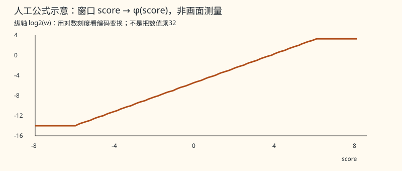

# 一块怎样改数字、交换内容，再接回两条旁路

上一站：[整帧作用图](L0_frame.md#beginner-frame) · 下一站：[两帧与重置](L1_00_history_primer.md) · [回索引](INDEX.md) · [词义随用随查](APPENDIX_beginner_glossary.md)

本页选**每位置32项的一头[TIN](APPENDIX_beginner_glossary.md#g011)连续块**，先教完整接线。一个位置保存一串内部数字，数字的每一项叫[通道](APPENDIX_beginner_glossary.md#g007)；它不一定代表可见颜色。一个[窗口](APPENDIX_beginner_glossary.md#g015)是8×8个这样的位置，下面用三个位置缩小故事。缩小的数字例全部是**人工教学，不是测量、模型系数或真实网络输出**；真实块仍按64个位置、每头32项及原舍入规则计算。[实际接线](L3_tin_window.md#tin-window)

## 先各自改自己的数字串

[前馈](APPENDIX_beginner_glossary.md#g037)处理（FFN）在这里先对每个位置单独组合通道，再让每项经过同一个函数G，最后组合回原来的项数。这一小段不向邻居取内容。[投影](APPENDIX_beginner_glossary.md#g038)就是“按系数重新组合一串数”；扩张/收缩指中间项数增加/减少，不是把图片放大/缩小。G让每项随自己的大小改变，不是只有开/关两种输出。

~~~mermaid
flowchart LR
    A["位置甲：2项"] --> A4["组合成4项"] --> AG["各项经过G"] --> A2["组合回2项"]
    B["位置乙：2项"] --> B4["组合成4项"] --> BG["各项经过G"] --> B2["组合回2项"]
~~~

**人工组合例**：甲的(1,2)可先组合为(1,2,3,−1)，乙的(2,1)可组合为(2,1,3,1)；例如第三项取前两项相加、第四项取相减。这只演示“同一位置内组合”，没有使用真实[权重](APPENDIX_beginner_glossary.md#g079)。G的真实单输入形状、人工x=4得到出口7的例子见[门函数](L3_ffn.md#gate)。实际所选块是32→128→G→32，不照搬这个2→4的玩具宽度。

## 再问：这个位置该取谁的内容？

每个位置从前馈结果生成三份数：Q是它拿来问的比较数，K是别人拿来被比较的数，V是最后可能取回的内容。三份都由内部数字投影得到，不是三张输入图。实际Q/K还各自整体[缩放](APPENDIX_beginner_glossary.md#g031)每组32项；V不做这一缩放。

**人工三位置故事，暂用一项代替32项，忽略精度与[位置偏置](APPENDIX_beginner_glossary.md#g052)**：甲拿Q=1，与甲/乙/丙的K=−1/0/1逐项相乘并求和，得到分数−1/0/1。三处V的内容人为设为2/4/8。将分数变成正数、除以总量得到[份额](APPENDIX_beginner_glossary.md#g048)，就能算“甲取甲多少、取乙多少、取丙多少”；其余位置各用自己的Q再问一次。实际分数还可能带位置偏置，不能把本例当真实头的计算输入。

| 同一人工分数 | 普通[softmax](APPENDIX_beginner_glossary.md#g047)：exp(s−最大分数)后的份额 | 本链窗口φ(s)的正数 | φ(s)除实数总量后的份额 |
|---:|---:|---:|---:|
| −1 | 0.090031 | 0.00927734375 | 0.091787 |
| 0 | 0.244728 | 0.025390625 | 0.251208 |
| 1 | 0.665241 | 0.06640625 | 0.657005 |

普通softmax先取[指数](APPENDIX_beginner_glossary.md#g047)，再除总量；减最大分数可避免中间数过大，不改变理想实数份额。甲的内容组合约为6.4809。本链窗口列先按真实分数变换算φ，再为教学用实数相除，内容组合约6.4444；**份额与内容组合尚未经过真实[half](APPENDIX_beginner_glossary.md#g054)[分母树](APPENDIX_beginner_glossary.md#g050)、倒数表、粗格式[量化](APPENDIX_beginner_glossary.md#g061)或[矩阵](APPENDIX_beginner_glossary.md#g051)累加**，不把它们称为网络结果。两种份额不相同，不据此猜训练意图。[人工计算脚本与结果](examples/beginner_r04m.py)会核对表中显示舍入。

下图横轴是分数 s；令 w=φ(s)>0，纵轴画的是 log2(w)。纵轴的负刻度仍对应正的 w，例如 log2(w)=−4 表示 w=1/16。

φ的做法是先乘加、夹到范围内，再改存储[编码](APPENDIX_beginner_glossary.md#g057)；不是对数值乘32，也不是精确exp。人工c=1.5的half编码为0x3e00：窗口变换后编码0x4000，解读为2；数值1.5×32却是48。指数形状来自编码中的位进入新的指数档，为什么训练采用它仍未知。[精确变换](L3_attention_softmax.md#window-attention)

## “先除还是后除”要画在不同位置

下图只解释转换位置。粗格式指[E4M3](APPENDIX_beginner_glossary.md#g055)，一种只能存较少数点的一字节格式；转换可能舍掉信息。

~~~mermaid
flowchart LR
    W["窗口：正权重"] --> WD["除总量"] --> WQ["转粗格式"] --> WV["组合V内容"] --> WO["结果再转粗格式"]
    G["全局：正权重"] --> GQ["转粗格式"] --> GV["组合V内容"] --> GD["除总量"] --> GO["结果再转粗格式"]
    style WQ fill:#ffe0a3,stroke:#9c5f00
    style GQ fill:#ffe0a3,stroke:#9c5f00
~~~

这里“除”在实现中是乘指定倒数，结合次序与每步舍入也保留。全局和窗口的φ、求和树还各有差别；不能只把除法移动一下就互相替换。现有[64键人工例](L3_attention_softmax.md#parallel-av-example)算到窗口−8、全局−3.25，差异不能全部归给转换位置。份额经舍入后也不保证恰好加成1。

## 现在把完整小块接起来

[旁路](APPENDIX_beginner_glossary.md#g016)是暂存较早的数字，让它绕过一段处理再接回。块内这种接回也叫[残差](APPENDIX_beginner_glossary.md#g017)；[seed](APPENDIX_beginner_glossary.md#g042)在这里指矩阵累加的**起始小计**，不是随机种子。

~~~mermaid
flowchart TD
    X["本块入口：每位置32项"] --> EX["各位置独立：组合成128项、逐项G"]
    EX --> CT["收缩回32项：第一步带入红线小计"]
    X --> ResFirst["入口数字乘旁路尺度"] --> CT
    CT --> Z["前馈结果z：保留一份未量化数"]
    Z --> QS["另转粗格式；生成Q/K/V"]
    QS --> CMP["Q/K整体缩放；比较位置、变正权重"]
    QS --> V["V内容"]
    CMP --> MIX["窗口先除总量、转粗格式，再组合V"]
    V --> MIX
    MIX --> PR["输出投影：第一步带入蓝线小计"]
    Z --> ResSecond["z乘另一旁路尺度"] --> PR
    PR --> Y["本块结果：每位置仍32项"]
    style ResFirst fill:#ffd9d9,stroke:#aa2222
    style ResSecond fill:#d9e9ff,stroke:#2255aa
    linkStyle 2,3 stroke:#aa2222,stroke-width:3px
    linkStyle 11,12 stroke:#2255aa,stroke-width:3px
~~~

红线从**块入口**开始，绕过扩张和G，在收缩的第一步加入；蓝线从**前馈结果z**开始，绕过比较与内容汇合，在输出投影的第一步加入。加入后每个[32项小篮](L1_00_numbers_primer.md#baskets)（每篮处理32对输入数的乘积，不是32个位置或线程）继续保存一次half小计，不能把两条线改画成全部算完后再加。此图专讲一头连续块；[上采样](APPENDIX_beginner_glossary.md#g021)入口、多头分组和全局分片的例外保留在[真实变体表](L3_ffn.md#channels)。

## 四种“分组”不要画成同一个轴

位置网格 → 选一个8×8窗口 → 将比较用的数字分成若干头 → 每头32项。[split16](APPENDIX_beginner_glossary.md#g013)有16个这样的头；它的FFN八组是另一套通道计算分组。设备执行的[lane](APPENDIX_beginner_glossary.md#g087)/CTA等是分配工作的坐标，也不是头或图片坐标。[分组细节](L3_split16_window.md#heads)

合上本页应能重画三步：各位置改自己的数字 → 比较并组合别处内容 → 在正确的两个起点接回早先数字。下一站看[整帧六条旁路](L0_frame.md#beginner-frame)，或[历史时间线](L1_00_history_primer.md)。
