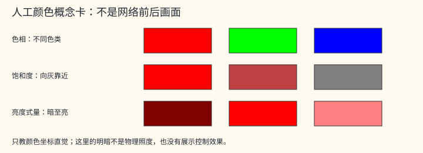

# L3.b70-history-output：末块、显示输出与历史回路

> 本页有些证据链接指向作者的私有项目档案（`../../../experiments/…`、`E:/…` 等），在公开仓库里打不开，只作出处记录保留；说明见[证据路径图例](INDEX.md#private-links)。

<!-- beginner-r04m:start intro -->

【入门简化】先区分四个对象：①三个预测数改动RGB；②有[历史](APPENDIX_beginner_glossary.md#g024)时的第四预测数参与混合[份额](APPENDIX_beginner_glossary.md#g048)；③结果图的第四存储分量固定为1；④显示强度控制最后与本帧原图备份的混合。②③④不是同一个第四数。默认先保存显示前[状态](APPENDIX_beginner_glossary.md#g002)，再另做显示；[两帧加reset时间线](L1_00_history_primer.md#timeline)先于坐标/颜色细式阅读。B70[资源](APPENDIX_beginner_glossary.md#g079)[置信尺度](APPENDIX_beginner_glossary.md#g052)先检查，允许才取旧图；B0条件历史是另一条路径。

~~~mermaid
flowchart TD
    Pred["预测出口"] --> Three["① 三个预测数 → 修改RGB"]
    Pred --> Fourth["② 第四预测数 → 只参与历史混合"]
    Three --> Colour["本帧新RGB"]
    Fourth --> Colour
    Colour --> Stored["③ 存储图：RGB加固定第四分量1"]
    Colour --> Display["④ 独立显示强度：与本帧原图备份混合"]
~~~

这些人工色样只教概念：[色相](APPENDIX_beginner_glossary.md#g033)是红/绿等色类，饱和度表示离灰多远，亮度式量反映明暗的一种计算约定，不等于物理照度。真实颜色链先做数值曲线，再有两轮分解/重组；临时[通道](APPENDIX_beginner_glossary.md#g007)次序不是最终RGB：

~~~mermaid
flowchart LR
    X["显示前颜色"] --> C["增益与曲线"] --> F["第一轮：按极值分解三量"] --> S["调整饱和度"] --> T["按临时通道顺序重组"] --> R["第二轮：按另一顺序分解"] --> S2["幂式饱和度变换"] --> RGB["重组成最终RGB"] --> I["与本帧备份按显示强度混合"]
~~~

这是下方[真实两轮接线](#post-reconstruct)的简化，不用人工色样宣称实际画面效果，也不将它替换成标准库的一次颜色空间往返。
<!-- beginner-r04m:end intro -->

## 156路线写借用合同（V01.05，排名70）

整数[纹理](APPENDIX_beginner_glossary.md#g027)键集合恰为{1,2,3,6}时，默认编号L155写id2；否则L155写id9。L156写id6、L157写id2。[workspace](APPENDIX_beginner_glossary.md#g082)始终标可写；每对buffer只要一方可写，就拒绝同一底层owner或相交半开字节区间。owner递归解memoryview.obj或base，循环拒绝；多维span以各维 `(shape−1)*stride` 的正/负部分求low/high，再加itemsize，支持负stride。两只读对象之间不检查冲突；extent不可取得时仍检查owner相同，不能称完整地址证明。该接口用默认编号，不再减一次路线编号。[R2c owner_guard.py:8–39](../../../experiments/parity-cpp-param-change-r01-20261024-codex/stage_d1b_r2c/returned/snapshot/candidate/runtime/owner_guard.py#L8)。

## B70解包、头排列与视图（F43.02/F43.47，排名77、81）

[矩阵](APPENDIX_beginner_glossary.md#g051)沿用[TIN普通tile字节式](L3_tin_window.md#resource-layout-r04l)，内部列主 `cols[n*K+k]`；w1(32,128)@0、w2(128,32)@0x1000、qkv(32,96)@0x20d0、[proj](APPENDIX_beginner_glossary.md#g038)(32,32)@0x4ce0。[half](APPENDIX_beginner_glossary.md#g054)数组fc/sin/cos/ac各32项，[基址](APPENDIX_beginner_glossary.md#g084)0x2010/0x2050/0x2090/0x50e0；scale为0x4cd0处[F32](APPENDIX_beginner_glossary.md#g056)经[RN16](APPENDIX_beginner_glossary.md#g059)。两个4×16 half头的地址是 `base+(4*c+k//4)*16+2*(k%4)`，base=0x5130/0x5330；不把中间空字节误作相邻系数。[outtail.cpp:77–85](https://github.com/Ashley-QwQ/GlassBox-NR/blob/e4a9b4214c723015ff4a99d73f13aa9a4a8ed1ec/cpp/chain_outtail_optm/outtail.cpp#L77)。

`km=(0,1,8,9,2,3,10,11,4,5,12,13,6,7,14,15)`，头的两路输入 `a[k]=Y[km[k]], b[k]=Y[16+km[k]]`；先以[+0](APPENDIX_beginner_glossary.md#g070)算a的[K16](APPENDIX_beginner_glossary.md#g065)，half输出作为b的[seed](APPENDIX_beginner_glossary.md#g042)，不能拼成一次K32。[reset](APPENDIX_beginner_glossary.md#g032)计算RGB三头，temporal可算第四头；trace仍仅输出RGB。[outtail.cpp:94](https://github.com/Ashley-QwQ/GlassBox-NR/blob/e4a9b4214c723015ff4a99d73f13aa9a4a8ed1ec/cpp/chain_outtail_optm/outtail.cpp#L94)。

bias索引以query=(y,x)、key=(ky,kx)的12个坐标位定义，输出从高到低依次是 `(y2,x2,ky2,kx2,y0,x1,x0,ky0,kx1,ky1,y1,kx0)`；读取 `LE16(resource+0x2cd0+2*index)`。[skip](APPENDIX_beginner_glossary.md#g016)的C32 [TIN](APPENDIX_beginner_glossary.md#g011)物理地址直接用[双向视图式](L3_tin_window.md#view-layout-r04l)；feature [outview](APPENDIX_beginner_glossary.md#g022)物理地址为 `16*((c//16*(NH//2)+y//2)*(NW//2)+x//2)+Q_inverse[c%16]`。这些是CPU布局式；B69独立原生坐标仍[UNKNOWN](APPENDIX_beginner_glossary.md#g104)。[outtail.cpp:79–82](https://github.com/Ashley-QwQ/GlassBox-NR/blob/e4a9b4214c723015ff4a99d73f13aa9a4a8ed1ec/cpp/chain_outtail_optm/outtail.cpp#L79)。

## B70分母与当前颜色坐标（排名79、83）

本页 `T_rcp/T_ex/T_lg` 分别是认证 RCP/EX2/LG2 的 [F32 数值包装](L4_mufu.md#value-wrapper) 的短写；数字后缀标记调用站点。输入和返回值是 F32 数值；取位型与解码不新增舍入并保留零的符号，认证成员与接受域仍按各站点检查。

既有64项有序half[归约](APPENDIX_beginner_glossary.md#g050)后，先 `d=max_half(den,0x0410)`，再 `r=RN16(T_rcp(F32(d)))`，每权重 `Q8(RN16(weight*r))`。这里使用[raw32](APPENDIX_beginner_glossary.md#g057) [RCP](APPENDIX_beginner_glossary.md#g072)包装，没有TIN的[0x1c00,0x60e0]拒绝；函数数据仍TABLE。[outtail.cpp:91–92](https://github.com/Ashley-QwQ/GlassBox-NR/blob/e4a9b4214c723015ff4a99d73f13aa9a4a8ed1ec/cpp/chain_outtail_optm/outtail.cpp#L91)，[函数合同](L4_mufu.md#lookup-contract-r04l)。

令FA/FM/FF分别是[既有F32 add/mul/fma边界](L4_fp32_ftz.md#fp32-ftz)，`iw=T_rcp(F32(CW)), ih=T_rcp(F32(CH))`。`u=FM(FF(FM(FA(F32(x),0.5),iw),CB+0x48,CB+0x40),CB+0x50)`，`v=FM(FF(FM(FA(F32(y),0.5),ih),CB+0x4c,CB+0x44),CB+0x54)`，六个[CB](APPENDIX_beginner_glossary.md#g083)字段均f32。用binary64核 `abs(u*CW−0.5−x)≤1/1024`、y同式；失败拒绝，成功才按当前纹理pitch读texel中心。不能将CB变换省成(x+0.5)/W。[outtail.cpp:85、95](https://github.com/Ashley-QwQ/GlassBox-NR/blob/e4a9b4214c723015ff4a99d73f13aa9a4a8ed1ec/cpp/chain_outtail_optm/outtail.cpp#L95)。

## S157父分支的零符号（F44.02/V04.02，排名217、224）

[准入](APPENDIX_beginner_glossary.md#g101)谓词是“父浮点谓词 OR 15条精确u32元组”。父分支逐F32数值比较 `exposure==−0.1f, contrast==−0.25f, satgain==−0.1f, gain2==0, strength==1`；因此gain2的+0/−0都通过父分支，[NaN](APPENDIX_beginner_glossary.md#g069)比较不通过。扩展15项才按[附录逐位表](APPENDIX_evidence_history.md#param-change-tuples-r04h)比较，不[插值](APPENDIX_beginner_glossary.md#g020)、不把父分支称为整组逐位唯一。[父源码:70–71](https://github.com/Ashley-QwQ/GlassBox-NR/blob/e4a9b4214c723015ff4a99d73f13aa9a4a8ed1ec/cpp/chain_outtail_optm/outtail.cpp#L70)，[R2c:69–90](../../../experiments/parity-cpp-param-change-r01-20261024-codex/stage_d1b_r2c/returned/snapshot/candidate/repo/cpp/opt/M/outtail/outtail.cpp#L69)。

【CPU 重建／CENSUS】下文按输入、颜色修正、历史融合和显示处理解释接线；参数分支证据另见附录。训练动机及拆核设计原因未知，不逐片补推测。

[整串目录](INDEX.md) · 上层：[B70](L2_09_b70.md)、[共享复制](L2_01_prepare.md#copy)、[L157](L2_10_output.md#postprocess) · 前一端：[B0](L3_b0_input.md#b0-noise-reprojection)

## 本页局部记号

全局格式、运算与证据标签见[INDEX](INDEX.md#形状与工作区记号)。

| 局部符号 | 含义 |
|---|---|
| dh、confidence | 末端half预测[向量](APPENDIX_beginner_glossary.md#g076)、资源中的置信尺度 |
| a,b,c,δ；I | L157四个F32控制标量；最终显示强度 |
| HSL_Fwd / HSL_Rev、Hue | 正/逆通道次序分解、分段色相重组 |
| h,s,l | 色相、饱和度、亮度式量，不是[launch](APPENDIX_beginner_glossary.md#g080)编号 |

**尾段来源按决定 40 表述：逻辑经分析 NVIDIA 二进制得到，代码为独立重写，经 [GPU](APPENDIX_beginner_glossary.md#g078) 实测逐字节验证。** 这适用于 B70/S157；它不表示逻辑未经二进制分析，也不扩大实测输入域。出处：[用户决定 40:299–309](../../../tasks/USER_DECISIONS_20261012_ZH.md#决定-402026-10-20用户q1-审计后的发布裁定)、[M2 RESULT](../../../experiments/parity-cpp-m2-release-clean-r01-20261020-claude/RESULT_ZH.md)。本页只列行为、参数和数据格式。

### L3.b70-history-output 两个出口、一条跨帧回路（L155–L157）

- 是什么：B70 产生显示处理前的状态；L156 保存它，L157 另做显示合成。
- 输入 → 输出：[解码](APPENDIX_beginner_glossary.md#g009)与 B0 [特征](APPENDIX_beginner_glossary.md#g008)、当前 RGB、有效历史和 [MV](APPENDIX_beginner_glossary.md#g023) → id9，再分别流向 id6 与 id2。
- 怎么算：
  ~~~text
  1. B69 主路与 B0.full 旁路 → B70 窗口块 → 末端 half 预测。
  2. 用预测修正当前颜色，得到 encoded RGB。
  3. 历史有效且置信尺度大于零时，重投影原始历史 RGB 并作融合混合。
  4. RGB 以 RZ16、alpha=1 写 id9。
  5. L156 按行复制 id9 的 RGBA16F 到 id6。
  6. L157 读 id9 与 id10，经颜色链及 intensity 合成，写 id2。
  7. 下一帧 B0 / B70 读 id6；显示后的 id2 不替代历史。
  ~~~
- 数值规则：状态[发布](APPENDIX_beginner_glossary.md#g091)与显示发布都是 half，但先后计算和[夹取](APPENDIX_beginner_glossary.md#g049)位置不同；不要把 L157 的颜色变换送回历史。
- 我们怎么知道：[CENSUS](APPENDIX_beginner_glossary.md#g100)，[outtail.cpp:85–105](https://github.com/Ashley-QwQ/GlassBox-NR/blob/e4a9b4214c723015ff4a99d73f13aa9a4a8ed1ec/cpp/chain_outtail_optm/outtail.cpp#L85)；具名多帧门见[证据表](#evidence)。
- 往下：[B70 网络](#b70-network)、[原始颜色](#b70-current)、[时域分支](#b70-temporal)、[复制](#copy)、[显示](#postprocess)、[reset 与 carry](#loop)。

~~~mermaid
flowchart LR
  Caller["本帧颜色 / MV / params"] --> B0["B0"]
  Hist["id6 历史"] --> B0
  B0 --> Net["编码 → 瓶颈 → 解码 B69"]
  B0 -->|"full skip"| B70["B70"]
  Net --> B70
  Caller --> B70
  Hist --> B70
  B70 --> S9["id9 RGBA16F"]
  S9 --> Copy["L156 逐行复制"]
  Copy -->|"下一帧"| Hist
  S9 --> Post["L157"]
  Base["id10 显示基底"] --> Post
  Post --> Display["id2 显示输出"]
~~~

### L3.b70.network 两路特征合并、窗口块与末端预测

- 是什么：把半分辨率解码特征与完整分辨率入口旁路合并，经一个[窗口](APPENDIX_beginner_glossary.md#g015)块生成逐像素预测。
- 输入 → 输出：B69 outview [E4](APPENDIX_beginner_glossary.md#g055)[Hn/2,Wn/2,32]、B0.[full](APPENDIX_beginner_glossary.md#g018) E4[Hn,Wn,32]、B70 权重 → half dh[3]，有历史时为 dh[4]。
- 怎么算：
  ~~~text
  1. 每个 8×8 窗口的位置 x=8bx−4+tx，y=8by−4+ty。
  2. 在画布内：按 outview 布局读取主路 (x//2,y//2,c)，按 TIN 布局读取 full skip (x,y,c)。
  3. main=H×(decode(main_byte),s_main[c])；merge=HF(decode(skip_byte),s_skip[c],main)。
  4. Q8(merge) → 32→128 前馈扩张 / 门函数 → 128→32 收缩，seed=H×(merge,s_ff)。
  5. 画布外位置的 z 保持 half +0；所有窗内位置继续生成 Q/K/V。
  6. Q、K 各做 norm32，只有 Q 再乘查询尺度（K 不乘）；按带偏置窗口分数、指定分母和 AV 得到注意力结果。
  7. 最后投影以 H×(z,s_att) 为 seed，得到 yy[32] half。
  8. 按源码的通道置换拆成两个 16 项向量 a16、b16。
  9. dh[c]=HMMA_K16(b16,head2[c],HMMA_K16(a16,head1[c],seed=0))。
  10. reset/current-only 算前三项；历史句柄有效时多算第四项。
  ~~~
- 数值规则：主路物理长度为 8WnHn B，旁路为 32WnHn B；主路同一位置在 2×2 图像位置中复用，不作[双线性](APPENDIX_beginner_glossary.md#g029)插值。两路[尺度](APPENDIX_beginner_glossary.md#g031)、[残差](APPENDIX_beginner_glossary.md#g017)尺度、位置偏置和末端系数存为 half，四个窗口块矩阵存为 E4；不列权重值。源码中叫 sin/cos 的两路尺度是资源系数，不是这里调用正弦 / 余弦。
- 我们怎么知道：CENSUS，[outtail.cpp:77–94](https://github.com/Ashley-QwQ/GlassBox-NR/blob/e4a9b4214c723015ff4a99d73f13aa9a4a8ed1ec/cpp/chain_outtail_optm/outtail.cpp#L77)，HMMA 的两个 K16 发布见 [:60–61](https://github.com/Ashley-QwQ/GlassBox-NR/blob/e4a9b4214c723015ff4a99d73f13aa9a4a8ed1ec/cpp/chain_outtail_optm/outtail.cpp#L60)。
- 往下：[FFN门函数与merge残差](L3_ffn.md#channels)；复用 [QMMA](L3_qmma_e4m3.md#qmma-e4m3)、[norm32](L3_norm_nonfinite.md#norm32)、[窗口 attention](L3_attention_softmax.md#window-attention)；本块独有的颜色与历史交接见[下一片](#b70-current)。

### L3.b70.current 当前颜色、神经修正与 id9 格式

- 是什么：把前三项预测加到当前颜色路径，再决定是否混入历史。
- 输入 → 输出：id1 RGB、dh[0:3]、CB+0x30 (f32) → encoded RGB；最终 id9 为 W×H [RGBA16F](APPENDIX_beginner_glossary.md#g028)。
- 怎么算：
  ~~~text
  1. 由像素中心、宽高倒数和 params 的 UV 变换计算当前颜色坐标。
  2. 当前准入路径核对它与本像素中心的误差≤1/1024，再直接读取 id1[y,x]。
  3. 每个 RGB 分量：base=F32_FMA(color,0.125,−0.0625)。
  4. val=F32_FMA(F32(dh[c]),CB+0x30 (f32),base)。
  5. encoded[c]=Sat01(F32+(0,F32_FMA(val,8,0.5)))；先保留该 F32 结果。
  6. 无历史时 blended=encoded；有历史时按下一片计算 blended。
  7. 图像有效行内：id9.RGB=RZ16(blended)，id9.A=half(1)。
  ~~~
- 数值规则：不能将三次颜色变换代数合并成一个“颜色加预测”表达式。当前三档画布宽等于图像宽，下方 Hn−H 行不写到纹理；当前颜色 direct lookup 有坐标守卫，不是任意 UV 的通用 TEX。最终 B70 RGB 写回前没有新增 S 夹取；时域混合不能擅加显示分支的 clamp。
- 我们怎么知道：CENSUS，[outtail.cpp:85、94–97](https://github.com/Ashley-QwQ/GlassBox-NR/blob/e4a9b4214c723015ff4a99d73f13aa9a4a8ed1ec/cpp/chain_outtail_optm/outtail.cpp#L94)；纹理尺寸 / pitch / [身份](APPENDIX_beginner_glossary.md#g103)检查见 [:64–65、100–102](https://github.com/Ashley-QwQ/GlassBox-NR/blob/e4a9b4214c723015ff4a99d73f13aa9a4a8ed1ec/cpp/chain_outtail_optm/outtail.cpp#L100)。
- 往下：[历史原始 RGB 混合](#b70-temporal)、[L156](#copy)、[RZ 实算例](#worked-example)。

**dh[3] 不写成 [alpha](APPENDIX_beginner_glossary.md#g026)。** 它是时域分支的内部预测量；id9 的第四通道始终写 1。历史输入有效但资源置信尺度为零时，代码仍可计算第四预测量，却跳过历史采样函数；不能只凭[句柄](APPENDIX_beginner_glossary.md#g096)存在就断言这次数值输出消费了历史。

**[算子](APPENDIX_beginner_glossary.md#g035)直觉。** 忽略舍入与夹取，8×((0.125×color−0.0625)+s×dh)+0.5恒等于color+8×s×dh；dh=0时保留原色。实际三次F32_FMA、额外F32+0及Sat01各自的发布/零符号合同保留，不能按实数恒等式合并代码。

### L3.b70.temporal B70 自己的坐标链与五 tap

- 是什么：在当前像素处采 MV，生成历史位置，再对原始历史 RGB 作五次过滤采样。
- 输入 → 输出：id3 RG16F、id6 RGBA16F、params 的坐标变换 → weighted RGB 与归一化倒数。
- 怎么算：
  ~~~text
  1. rw=T_rcp(W)，rh=T_rcp(H)；ux=F32×(F32+(x,0.5),rw)，uy=F32×(F32+(y,0.5),rh)。
  2. mv_u=F32×(F32_FMA(CB+0x94 (f32),ux,CB+0x8c (f32)),CB+0x9c (f32))；mv_v 两轴对应，用 CB+0x98 (f32)/CB+0x90 (f32)/CB+0xa0 (f32)。
  3. 在 motion.sample(mv_u,mv_v) 取 mx,my。
  4. 当前准入 mode=1：ax=F32_FMA(CB+0xa4 (f32),mx,ux)，ay=F32_FMA(CB+0xa8 (f32),my,uy)。
  5. x0=F32+(floor(F32_FMA(W,ax,−0.5)),0.5)，t=clamp(F32_FMA(W,ax,−x0),0,1)；y0、v 同理用 H、ay。floor 后的 +0.5 与 clamp 都不能省。
  6. 按 B0 已展开的三次系数构造左 / 上 / 中 / 下 / 右五点、权重；此处倒数用 T_rcp。
  7. 历史点 sx,sy 再变换：hx=F32×(F32_FMA(CB+0x7c (f32),F32×(rw,sx),CB+0x74 (f32)),CB+0x84 (f32))；hy 用 CB+0x80 (f32)/CB+0x78 (f32)/CB+0x88 (f32)。
  8. history.sample(hx,hy,c) 返回原始颜色；不做 B0 的减 0.5、乘 gain。
  9. den=F32+(wr,F32+(wb,F32+(wc,F32+(wl,wt))))；inv=T_rcp(den)。
  10. weighted=F32×(top,wt)，依次 F32_FMA(left,wl,weighted)、F32_FMA(center,wc,weighted)。
  11. 再 F32_FMA(bottom,wb,weighted)、F32_FMA(right,wr,weighted)。
  ~~~
- 数值规则：F32 运算点、坐标 clamp、floor 前的 [FMA](APPENDIX_beginner_glossary.md#g063) 与加权顺序保留。sample 接受归一化坐标，内部乘纹理宽高后使用1/256定点小数格和联合8位分数权重，再执行有效贡献共[指数](APPENDIX_beginner_glossary.md#g058)截断与纹理 half ties-away；机制链接 [B0 的过滤说明](L3_b0_input.md#texture)，但 B70 的地址变换、RCP / [FTZ](APPENDIX_beginner_glossary.md#g068) 包装与最终混合单独绑定。外层当前函数要求 mode=1，不能将内部备用分支当新增支持域。
- 第 5 步的三个小例子（W=1920，只看 x 轴；三个 ax 都能用 F32 精确表示，FMA 结果也精确）：像素中心 ax=1/256，W·ax=7.5，得 x0=7.5、t=0；分数位移 ax=3/512，W·ax=11.25，得 x0=10.5、t=0.75；左边缘 ax=0，得 x0=−0.5、t=0.5，五点中的左右两点 x0−1、x0+2 再夹到 [0.5, W−0.5]，即 0.5 和 1.5。若漏掉 floor 后的 +0.5，三例的 x0 会变成 7、10、−1，t 变成 0.5、1（1.25 被夹回）、1，后续三次系数和五点位置都随之改变。这里对照的是 [b70_temporal.hpp:33–34](https://github.com/Ashley-QwQ/GlassBox-NR/blob/e4a9b4214c723015ff4a99d73f13aa9a4a8ed1ec/cpp/chain_outtail_optm/b70_temporal.hpp#L33) 的 CPU 源码，不对原生内部表示另作断言。
- 我们怎么知道：CENSUS，[b70_temporal.hpp:5–44、47](https://github.com/Ashley-QwQ/GlassBox-NR/blob/e4a9b4214c723015ff4a99d73f13aa9a4a8ed1ec/cpp/chain_outtail_optm/b70_temporal.hpp#L26)，mode 检查见 [outtail.cpp:85](https://github.com/Ashley-QwQ/GlassBox-NR/blob/e4a9b4214c723015ff4a99d73f13aa9a4a8ed1ec/cpp/chain_outtail_optm/outtail.cpp#L85)。
- 往下：[置信混合](#b70-mix)、[既有五 tap 系数](L3_b0_input.md#five-tap)、[保存门的范围](#evidence)。

### L3.b70.mix 第四预测量与融合历史修正

- 是什么：把第四预测量变成有界权重，用历史与当前 encoded 的差修正当前 RGB。
- 输入 → 输出：half dh[3]、资源 half confidence、weighted、inv、encoded → F32 blended。
- 怎么算：
  ~~~text
  1. confidence=Sat01(F32(资源置信 half))；非有限值拒绝。
  2. confidence≤0 时，不调用时域采样，blended=encoded。
  3. argument=F32×(F32(dh[3]),k)，k 的 F32 算法常量位型为 0xbfb8aa3b。
  4. sigmoid=T_rcp(F32+(T_ex(argument),1))。
  5. factor=Sat01(F32_FMA(sigmoid,confidence,0))。
  6. 每通道 delta=F32_FMA(inv,weighted,−encoded[c])。
  7. blended[c]=F32_FMA(factor,delta,encoded[c])，随后才 RZ16 发布。
  ~~~
- 数值规则：k 是负的 log2(e) 近似常量，使以 2 为底的 EX2 形成 logistic 型门；不是模型权重。confidence 和末端矩阵系数不列数值。归一化与减当前值共用第 6 行的一次 FMA，不能先得到归一化历史、再减当前值；也没有先将历史变成 B0 归一化 half 的步骤。
- 我们怎么知道：CENSUS，[b70_temporal.hpp:45–49](https://github.com/Ashley-QwQ/GlassBox-NR/blob/e4a9b4214c723015ff4a99d73f13aa9a4a8ed1ec/cpp/chain_outtail_optm/b70_temporal.hpp#L45)、[outtail.cpp:96](https://github.com/Ashley-QwQ/GlassBox-NR/blob/e4a9b4214c723015ff4a99d73f13aa9a4a8ed1ec/cpp/chain_outtail_optm/outtail.cpp#L96)；时域表 / params profile 守卫见 [stage_codec.inc:70–85](https://github.com/Ashley-QwQ/GlassBox-NR/blob/e4a9b4214c723015ff4a99d73f13aa9a4a8ed1ec/cpp/chain_outtail_optm/stage_codec.inc#L70)。
- 往下：[L156 状态保存](#copy)、[历史消费控制](#reset-controls)。

**4K 时域执行的时间界限。** 10-22 的统一 M f0→f1→f2 两填充自有链，实际执行了该 4K 历史入口；f2 使用本 fill 自有 f1 状态。它不是只配置了 b70_temporal.hpp，也不是用原生历史教师强制续接。更早的 1080 / 1440 时域结果另列，不把“4K f1/f2 本轮首次执行”说成所有几何直到 10-22 才有时域。[4K RESULT:19–21](../../../experiments/parity-cpp-4k-multiframe-r01-20261022-codex/RESULT_ZH.md#L19)。

### 当前颜色与置信混合：真实函数的人工像素

color RGB=(0.5,0.5,0.5)，人工预测dh在转half前为(0.01,0,−0.01,1)，host scale=0.03125；confidence人工取half(0.5)，预先给定过滤后weighted RGB=(0.75,0.25,0.5)、分母1。没有读取模型系数，也没有调用采样器/网络。

| 通道 | dh转half后的值 | base | val | encoded | delta | blended / [RZ16](APPENDIX_beginner_glossary.md#g060)编码 |
|---|---:|---:|---:|---:|---:|---|
| R | 0.01000213623 | 0 | 0.0003125667572 | 0.5025005341 | 0.2474994659 | 0.5929688215 / 38be |
| G | 0 | 0 | 0 | 0.5 | −0.25 | 0.4086176753 / 3689 |
| B | −0.01000213623 | 0 | −0.0003125667572 | 0.4974994659 | 0.002500534058 | 0.4984134734 / 37f9 |

第四预测量给argument=−1.442695022，真实EX2=0.3678794503，RCP(EX2+1)=0.7310585976，factor=0.3655292988。delta与blended用原F32_FMA；[脚本](examples/anatomy_r04i.py)直接抽取原颜色语句、原置信函数片段及EX2/RCP包装，核认证表SHA后执行，[结果](examples/anatomy_r04i.result.json)保存参数与位型。这是人工算术例，不是新的B70或模型验收。

### L3.b70.variants 默认158与156路线

| 路线 | 末端接线 |
|---|---|
| 默认158 | B70写id9，L156复制id9→id6，L157读id9/id10写id2 |
| 156 | 省去默认[L0](APPENDIX_beginner_glossary.md#g081)[基底](APPENDIX_beginner_glossary.md#g003)备份及L157独立后处理；本地0..155对应默认1..156，尾段写id2再复制id2→id6；只绑定1/2/3/6四纹理 |

156路线将同一尾部状态同时用于显示和下帧历史，[参数分支证据](APPENDIX_evidence_history.md#param-change)（measured on child candidate）。312 B post_block是另一参数布局，不因同属控制变化就视为156路线。

### L3.history.copy L156：id9(this) → id6(next)

- 是什么：逐行复制完整 RGBA16F 有效像素，保存下一帧所读的状态。
- 输入 → 输出：id9 的 W×H×8 B 像素载荷 → id6 的同形载荷。
- 怎么算：
  ~~~text
  1. 检查 params 源纹理句柄=id9、目标 surface=id6，宽高等于本帧几何。
  2. 对 y=0..H−1：src=id9.data+y×src_pitch。
  3. dst=id6.data+y×dst_pitch；memcpy(dst,src,8W)。
  4. RGBA 四个 half 的原始位型全部复制，无解码、量化或颜色变换。
  5. 下一帧保持 id6，另更新 caller 的颜色、MV 与参数。
  ~~~
- 数值规则：有效像素字节逐一相同；若 pitch 大于 8W，行尾 padding 不在复制范围内。所列紧密排列捕获的整张原始 RGBA16F 因而相同，不能把不同 pitch 的 backing allocation 全部字节也宣称相同。
- 我们怎么知道：CENSUS，[outtail.cpp:103](https://github.com/Ashley-QwQ/GlassBox-NR/blob/e4a9b4214c723015ff4a99d73f13aa9a4a8ed1ec/cpp/chain_outtail_optm/outtail.cpp#L103)；原生自身一致性保存记录 [history_inputs_v3.json](../../../experiments/parity-video-1080-multiframe-r01-20261006-codex/resume2-20261007/history_inputs_v3.json)为 5 条跨帧 [seam](APPENDIX_beginner_glossary.md#g106) 加 12 条帧内链接，合计 282,009,600 B、diff_bytes=0，17 项单字节[负控](APPENDIX_beginner_glossary.md#g102)被检出。
- 往下：[carry 与 reset](#loop)、[小型复制 / RZ 例](#worked-example)。

| 图像尺寸 | 每行复制（B） | 完整像素载荷（B） |
|---|---:|---:|
| 1920×1080 | 15,360 | 16,588,800 |
| 2560×1440 | 20,480 | 29,491,200 |
| 3840×2160 | 30,720 | 66,355,200 |

上述原生 seam 记录是采集自身一致性，不是 CPU parity；原 runner 正常结束仍为 NOT_PROVEN。CPU 自有状态链对原生的比较是后来的独立一层证据，见[表](#evidence)。

### L3.postprocess L157 的输入、分支与命名裁决

- 是什么：对 id9 做显式颜色变换，再与 id10 基底混合，只写显示 id2。
- 输入 → 输出：id9 / id10 的 RGB half、376 B params → id2 RGB RZ16、alpha=1。
- 怎么算：
  ~~~text
  1. 按图像像素 / pitch 读取 id9，先夹到 [0,1]。
  2. 以宿主标量作增益、三次曲线及两次 LG2 / EX2 往返。
  3. 以 max/min 分解 h/s/l，调整饱和度，分段重组临时通道。
  4. 按另一通道次序再次分解，再作饱和度幂式变换、重组 RGB。
  5. 夹取目标 RGB，与 id10 求差，再以 intensity 作 FMA 混合。
  6. 夹取最终 RGB，RZ16 写 id2；alpha 写 half(1)，不改 id6。
  ~~~
- 数值规则：**当前 [M2](APPENDIX_beginner_glossary.md#g107) 的这条受守卫分支是 HSL 型极值 / 色相 / 饱和度 / 亮度式计算**。其源码没有以 [LMS](APPENDIX_beginner_glossary.md#g034) 矩阵和立方根链执行 Oklab 转换；因此旧 ARCH 把这条入口概称“Oklab”的命名不能替代当前分支的实现。是否有其他原生分支含 Oklab 仍未由这里确认；也不能拿标准库 HSL 转换替换下面的特殊通道次序。
- 我们怎么知道：CENSUS，[outtail.cpp:70–75](https://github.com/Ashley-QwQ/GlassBox-NR/blob/e4a9b4214c723015ff4a99d73f13aa9a4a8ed1ec/cpp/chain_outtail_optm/outtail.cpp#L70)，与 [ARCH 旧解释 §6.5](../../../ARCHITECTURE_V3_ZH.md#65-s157cg2r_post_process_kernell157)对照；这里裁决的是当前代码行为，不把旧解释强行合成同一算法。
- 往下：[前段曲线与标量](#post-curve)、[分解 / 重组](#post-hsl)、[显示混合](#intensity)。

### L3.postprocess.curve 三个宿主标量：数值作用已读，API 名称未定

- 是什么：明确标量消费位置，同时保留“哪个宿主控制产生它”的未知。
- 输入 → 输出：a=CB+0x144 (f32)、b=CB+0x14c (f32)、c=CB+0x150 (f32)，另 δ=CB+0x154 (f32) → 后续颜色链。
- 怎么算：
  ~~~text
  1. ep=T_ex(a)；ea=T_ex(+0)，eb=T_ex(−0)，eg=T_ex(−δ)。
  2. 每个 id9 RGB：rawv=Sat01(F32+(0,F32(raw_half)))。
  3. x=Sat01(F32_FMA(rawv,ep,0))；x2=F32×(x,x)；twox=F32+(x,x)；three=F32+(−twox,3)。
  4. smooth=F32_FMA(x2,three,−x)；pre=F32_FMA(smooth,b,x)。
  5. u=T_ex_1(F32×(T_lg_0(pre),ea))。
  6. rgb=T_ex_3(F32×(T_lg_2(max(0,u)),eb))。
  7. 下一片的第一轮饱和度使用 Sat01(F32_FMA(s,F32+(c,1),0))。
  ~~~
- 数值规则：数学上曲线含 x²(3−2x)−x，但源码的每次加乘与 FMA 分组保留。ea/eb 即使为 1，也不能删掉 LG2/EX2 往返；它们使用已采映射及 site 接受域。M2 当前 guard 固定这组标量及 I=1，代码作用不是全部跨捕获标量取值已被验证的证据。
- 为什么这么算：a形成前置增益，b混合平滑曲线，c缩放第一轮饱和度；这是公式中的功能，不等于已确认的宿主API名称。
- 我们怎么知道：CENSUS，[outtail.cpp:68–75](https://github.com/Ashley-QwQ/GlassBox-NR/blob/e4a9b4214c723015ff4a99d73f13aa9a4a8ed1ec/cpp/chain_outtail_optm/outtail.cpp#L68)；宿主语义未定的来源见 [ARCH §10.2](../../../ARCHITECTURE_V3_ZH.md#102-参数字段审计host-params-audit-r01)。
- 往下：[h/s/l](#post-hsl)、[MUFU 定义域](L4_mufu.md#edges)。

| 标量 | 从当前代码可确认的作用 | 仍不能确认 |
|---|---|---|
| CB+0x144 (f32)的 a | T_ex(a) 为前置 RGB 增益 | 宿主把它称为什么、随内容或 UI 怎样生成 |
| CB+0x14c (f32)的 b | 混合 smooth 与 x 的 FMA 系数 | 是否对应某个独立“contrast”控制 |
| CB+0x150 (f32)的 c | 第一轮 s 的乘数为 F32+(c,1) | 是否对应某个独立“saturation”控制 |
| CB+0x154 (f32)的 δ | 第二轮幂式饱和度使用 T_ex(−δ) | 未测分支 / 非默认值的宿主合同 |

宿主字段命名的闭合路径：固定输入、历史与其余控制，逐个改变宿主API控件，记录五个CB字段的精确位型及reset/route；再做重复和单变量反控，区分宿主夹取与颜色函数的消费。该对照本轮NOT_RUN，不从局部变量名给UI字段定名。

### L3.postprocess.hsl 两种分解与分段 Hue

- 是什么：由 max/min 构造亮度与饱和度，按主导通道构造色相，再以分段函数重组。
- 输入 → 输出：F32 三分量 r,g,b → h,s,l；再由 p0,q,h → 一个通道。
- 怎么算：
  ~~~text
  1. mx=max(b,max(r,g))，mn=min(b,min(r,g))；l=F32×(F32+(mx,mn),0.5)。
  2. 若 mx==mn：h=s=0，立即返回；否则 d=F32+(mx,−mn)，rd=T_rcp(d)。
  3. HSL_Fwd 的色相分支：mx==r 用 F32_FMA(F32+(g,−b),rd,g<b?6:0)；
       否则 mx==g 用 F32_FMA(F32+(b,−r),rd,2)，否则 F32_FMA(F32+(r,−g),rd,4)。
  4. HSL_Rev 则依次用 F32_FMA(F32+(b,−g),rd,2)、F32_FMA(F32+(r,−b),rd,r<b?6:0)、F32_FMA(F32+(g,−r),rd,4)。
  5. h=F32×(分支值,1/6)；sm=F32+(mx,mn)，minus=F32+(−mn,F32+(2,−mx))。
  6. s=F32×(d,T_rcp(l≤0.5?sm:minus))。
  7. Hue(p0,q,t)：t<0 时 F32+(t,1)，t≥1 时 F32+(t,−1)；d=F32+(q,−p0)。
  8. a0=F32_FMA(F32×(d,6),t,p0)；c0=F32_FMA(F32×(d,F32+(2/3,−t)),6,p0)。
  9. 返回 t<1/6?a0 : t<0.5?q : t<2/3?c0 : p0。
  ~~~
- 数值规则：分数常量按源码 F32 精度；灰度分支避免对 d=0 求倒数。相等最大值按 r、再 g、再 b 的源码判断次序选择，不任意[重排](APPENDIX_beginner_glossary.md#g019)。
- 我们怎么知道：CENSUS，[outtail.cpp:72–73](https://github.com/Ashley-QwQ/GlassBox-NR/blob/e4a9b4214c723015ff4a99d73f13aa9a4a8ed1ec/cpp/chain_outtail_optm/outtail.cpp#L72)。
- 往下：[两轮接线](#post-reconstruct)、[FTZ 边界](L4_half_arith.md#f32-boundaries)。

### L3.postprocess.reconstruct 保留临时通道次序的两轮重组

- 是什么：两轮分解 / 重组并不直接等于一次标准 RGB↔HSL 往返。
- 输入 → 输出：曲线后的 rgb、c、eg → 显示目标 RGB。
- 怎么算：
  ~~~text
  1. (h,s,l)=HSL_Fwd(rgb)；sa=Sat01(F32_FMA(s,F32+(c,1),0))。
  2. 给定 sa：q=l<0.5?F32×(l,F32+(sa,1)):F32_FMA(−l,sa,F32+(l,sa))；p0=F32+(F32+(l,l),−q)。
  3. tmp0=Hue(p0,q,h)，tmp1=Hue(p0,q,F32+(h,1/3))，tmp2=Hue(p0,q,F32+(h,−1/3))。
  4. (h,s,l)=HSL_Rev(tmp0,tmp1,tmp2)，而不是按最终 RGB 次序调用 HSL_Fwd。
  5. gray=(tmp0==tmp1 && tmp1==tmp2)。
  6. sa=Sat01(F32+(0,T_ex(F32×(eg,T_lg(gray?1:s)))))；gray 时再将 sa=0。
  7. 按第 2 行重算 p0、q。
  8. 最终 RGB=[Hue(p0,q,F32+(h,1/3)),Hue(p0,q,h),Hue(p0,q,F32+(h,−1/3))]。
  ~~~
- 数值规则：临时顺序和逆向色相分支都保留；不能将 tmp0/1/2 直接当最终 R/G/B。灰度时用 1 进入对数链，最后仍明确置饱和度零，不由近似 pow 替代。
- 我们怎么知道：CENSUS，[outtail.cpp:75](https://github.com/Ashley-QwQ/GlassBox-NR/blob/e4a9b4214c723015ff4a99d73f13aa9a4a8ed1ec/cpp/chain_outtail_optm/outtail.cpp#L75)。
- 往下：[强度混合](#intensity)、[RZ](#worked-example)。

### L3.postprocess.intensity 显示强度上限与最终 RZ

- 是什么：显示目标与 id10 基底之间的最终混合；不是 B70 的学习残差或历史置信权重。
- 输入 → 输出：目标 RGB、id10 RGB、I=CB+0x120 (f32) → id2 RGBA16F。
- 怎么算：
  ~~~text
  1. 已捕获控制的 intensity 上限为 1.0；>1 的 1.5 / 2.0 对照输出等于 1.0。
  2. 对当前 M2 入口，要求传入 I==1，未实现任意 I 的通用入口。
  3. 每分量 d=F32+(Sat01(target[c]),−base[c])。
  4. mixed=Sat01(F32_FMA(I,d,base[c]))。
  5. id2.RGB=RZ16(mixed)，id2.A=half(1)。
  ~~~
- 数值规则：上限控制观测与代码入口分开：outtail.cpp:71 自己只检查 I==1，没有实现一般 min(I,1)。这里不虚构截断发生在 shader 的哪一步；也不从上限推出未测负 [intensity](APPENDIX_beginner_glossary.md#g004) 的合同。0.5 的独立输入闭合限 A/sm75/320×240 两个单帧样本，不扩到 M2 的一般动态参数。
- 我们怎么知道：CENSUS，[outtail.cpp:71、75](https://github.com/Ashley-QwQ/GlassBox-NR/blob/e4a9b4214c723015ff4a99d73f13aa9a4a8ed1ec/cpp/chain_outtail_optm/outtail.cpp#L71)；CONTROLLED / 历史控制摘要，[ARCH 参数表:1305](../../../ARCHITECTURE_V3_ZH.md#L1305)、[P10c RESULT](../../../experiments/parity-gpt-cp-intensity-input-closure-p10c-20260919/RESULT_ZH.md)。
- 往下：[实际 RZ 例](#worked-example)、[参数变化路线边界](#variants)。

### S157的精确控制元组

CB+0x120 (f32)/CB+0x144 (f32)/CB+0x14c (f32)/CB+0x150 (f32)/CB+0x154 (f32)分别为I/a/b/c/δ；受限入口为[父浮点谓词OR扩展逐位元组](#parent-predicate-r04l)，颜色算术与查表译码不变，[参数分支证据](APPENDIX_evidence_history.md#param-change)（measured on child candidate）。站点成员、[函数表](APPENDIX_beginner_glossary.md#g074)及其余守卫同时生效，单通道函数域不替代跨通道颜色分支的绑定。

### L3.history.loop 跨帧存什么，reset 改什么

- 是什么：把 CPU 自有状态、宿主帧字和无状态噪声重建分别接续。
- 输入 → 输出：本帧末 workspace / 纹理、下一帧 caller 输入与 params → 下一次 B0 / B70。
- 怎么算：
  ~~~text
  1. 跨帧保留整片 workspace 与纹理状态；其中 id6 是刚由 id9 复制的历史。
  2. 每帧按合同刷新 id1 颜色、id3 MV 和 CB，不用原生中间状态作预测输入。
  3. B0 的 f=CB+0xc8 (u32) 从本帧实际 params 读取。
  4. 噪声由未镜像坐标与 f 重新散列；没有需要逐像素推进或携带的 RNG 状态。
  5. API reset 是原生宿主输入；CPU 重建不调用该 API，而消费其对应的 reset 参数合同。
  6. 已捕获切镜帧把计数字置 0、历史句柄置 0，B0 / B70 按这些参数跳过历史分支。
  7. reset 后不要求先把整片旧历史清零；本帧生成的新 id9 经 L156 替换 id6。
  ~~~
- 数值规则：视频绝对帧号与 f 不同：scene_cut 的绝对 f8 使用噪声计数字 0，f9 为 1。仅把计数字改成 0 不等于满足整套 reset profile；B0 的 mode / 句柄守卫与 B70 的 profile 守卫都要成立。噪声表是不可变函数资产，不是跨帧随机状态。
- 我们怎么知道：CENSUS，[B0 守卫](L3_b0_input.md#guards)、[B70 分支:100–102](https://github.com/Ashley-QwQ/GlassBox-NR/blob/e4a9b4214c723015ff4a99d73f13aa9a4a8ed1ec/cpp/chain_outtail_optm/outtail.cpp#L100)；CONTROLLED / MEASURED，[scene_cut RESULT:17–35](../../../experiments/parity-cpp-1080-multiparam-r03-20261018-claude/RESULT_ZH.md#L25)。
- 往下：[C1–C5](#reset-controls)、[多帧门](#evidence)、[噪声帧字](L3_b0_input.md#noise)。

p5有历史时，B00将自身id6经当前id3[重投影](APPENDIX_beginner_glossary.md#g025)到条件向量；B70仍在原始颜色域混合历史，reset则不消费旧历史并以本帧状态覆盖id6；[参数分支证据](APPENDIX_evidence_history.md#param-change)（measured on child candidate）。

## scene_cut 的 C1–C5：消费历史与切镜隔离分开验证

| 控制 | 实际操作 | 预登记结果 / 实测 | 支持的结论 |
|---|---|---|---|
| C1 | 在绝对 f8 使用 f9 的非 reset params；仅该控制绕过帧计数准入门 | DIFF / DIFF | reset 参数本身影响结果，比较器能检出反事实 |
| C2 | f0 末 id6 改一字节，再跑非 reset f1 | DIFF / DIFF | 该输入实例的正常帧实际消费历史 |
| C3 | f7 末 id6 改一字节，再跑 reset f8 | MATCH / MATCH | 该 reset 帧隔离了旧历史 |
| C4a / C4b | f8 分别带自有 f7 carry，或新进程 fill00 起步 | MATCH / MATCH，二者同终图 | 本例 warm / cold reset 在输出上等价 |
| C5 | 新进程从 f8 起；workspace=A5、状态纹理为零、无 carry | MATCH / MATCH | 本例 reset 结果不依赖携带的旧状态；不证明任意初值[全域](APPENDIX_beginner_glossary.md#g111)独立 |

来源：[scene_cut RESULT:25–42](../../../experiments/parity-cpp-1080-multiparam-r03-20261018-claude/RESULT_ZH.md#数值敏感与隔离控制各-158-launch单帧)。这些是数值控制；原配置阶段的准入负控、后续数值阶段的 DIFF 和主链 16 帧 [FINAL](APPENDIX_beginner_glossary.md#g105) 匹配是不同分母。C1/C2 的预期 DIFF 不是主链数值失败。

## 多帧比较范围

【验证记录】[三档多帧、sceneA、scene_cut 的完整结果/分母/构建账](APPENDIX_evidence_history.md#history-evidence)已迁移。1080/1440 旧门绑定 854，4K 三帧绑定统一 M，sceneA 绑定 M9d/854 的 FINAL_SHA256_ONLY；不称 M2 新多帧逐 launch 门。原生累计声明写集/roles、参考 FULL/六纹理和 FINAL 的范围分开，终图不反推隐藏状态唯一。

1440 f1/f2 六纹理仅五个原生时点，f3 经输入平移及跨进程自有检查点续接，f4/f5 NOT_RUN；4K f0 L0 两个 FULL 未观测（NOT_OBSERVED），A5 早期已写区/[补集](APPENDIX_beginner_glossary.md#g093)分别比较，f3+ NOT_RUN。sceneA 后半帧 params 由冻结模板合成而非原生捕获；scene_cut 为 FINAL only，不证明 midstream f4+ 或 p5。原冻结验证状态按具名报告保留。

## 实际计算例：RZ 与行复制

本轮从实际 Python 参考中仅提取 f32_to_f16_round_toward_zero 函数，不导入网络或读取目标。合成例还核对两个不同 pitch 的有效像素复制，展示“载荷相同”与“行尾 padding 保留”的区别。

[RZ与复制的真实代码脚本](examples/b70_rz_copy_r04i.py)在仓库根目录运行；正文保留输入输出。

实际输出：

| F32 输入 | RN16 值 / 编码 | RZ16 值 / 编码 |
|---:|---|---|
| 0.5004000067710876 | 0.50048828125 / 0x3801 | 0.5 / 0x3800 |
| 0.9998999834060669 | 1 / 0x3c00 | 0.99951171875 / 0x3bff |
| −0 | −0 / 0x8000 | −0 / 0x8000 |
| 1 | 1 / 0x3c00 | 1 / 0x3c00 |

合成的 2×2 RGBA16F 有效载荷共 32 B，复制后逐字节相同，目标行尾仍为 A5。它核对本片的原语与跨度，不是新的 B70 / L157 或整链数值门。

F16矩阵算术继续下钻：[L4.hmma：K16公共格、seed、发布与硬件边界](L4_hmma.md#hmma)。

### L157：人工RGB走完曲线与两轮重组

【真实代码实算】输入raw RGB=(0.25,0.5,0.75)，base=(0.125,0.25,0.375)。控制a/b/c/δ/I按当前受守卫标量取(−0.1,−0.25,−0.1,0,1)，它们是宿主控制而非模型系数。脚本抽取整个s157函数，采用认证EX2/RCP/[E1](APPENDIX_beginner_glossary.md#g110)函数资产与原reach检查，没有libm替代或原值缺失回退。

| 阶段 | R或第0量 | G或第1量 | B或第2量 |
|---|---:|---:|---:|
| 前置增益及夹取x | 0.2332582474 | 0.4665164948 | 0.6997747421 |
| 曲线pre | 0.25711146 | 0.4706831574 | 0.6787893772 |
| LG2/EX2往返后的rgb | 0.2571115196 | 0.4706831872 | 0.6787894964 |
| HSL_Fwd的h,s,l | 0.5822532773 | 0.4505583048 | 0.4679505229 |
| 第一轮临时次序tmp0/1/2 | 0.4704099298 | 0.2781954408 | 0.657705605 |
| HSL_Rev的h,s,l | 0.5822532773 | 0.4055024683 | 0.4679505229 |

第二轮再按原Hue通道次序重组、I=1融合、夹取并RZ16；最终RGBA half编码为 **3473 3786 3942 3c00**。原s157与只增加中间输出的副本最终八字节相同。[脚本](examples/substitutions_r04g.py)、[stdout与源/表SHA](examples/substitutions_r04g.result.json)可复跑。这里执行人工1像素的真实算术体及其标量/函数域检查，不调用模型，也不把1×1替身几何当成公开模块或原生网络的新支持域。
